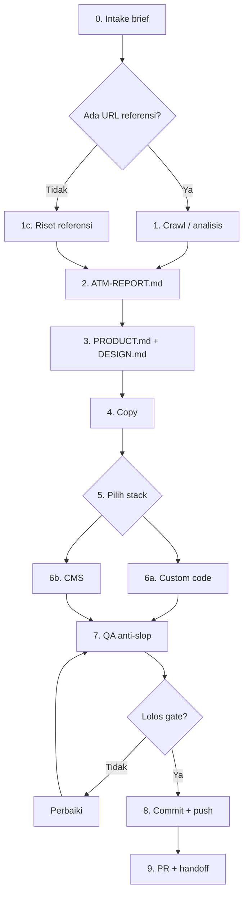

# Riset Awal: Skill "agentic-weave" (dulu anti-ai) (Anti-Slop) untuk AI Agent

> Sumber: laporan mode Research, 29 Oktober 2026. Saat riset ini dibuat, repo belum bisa diakses (private), jadi gap analysis di Bab 1 masih berupa checklist umum. Hasil review isi repo yang sebenarnya ada di `2026-10-29-02-gap-analysis.md`.

Skill anti-slop yang kamu mau bisa dibuat, dan hampir semua komponennya sudah punya padanan open-source yang matang. Rekomendasi utamanya: pecah skill menjadi satu core `SKILL.md` yang ramping plus folder `references/` per domain, ikuti spesifikasi Agent Skills (agentskills.io) dan `AGENTS.md`, lalu batasi fitur crawl/clone ke situs milik sendiri, situs klien, atau situs yang sudah memberi izin untuk penggunaan publik.

## TL;DR

- **Bisa dibuat, dan jangan mulai dari nol.** Anthropic `frontend-design`, Impeccable (Paul Bakaus), `miqdadbadjuber/anti-slop`, keluarga `humanizer` (berbasis "Wikipedia: Signs of AI writing"), dan Firecrawl `branding` format sudah mencakup sebagian besar kebutuhan. Nilai tambah skill kamu ada di tiga hal: **flow end-to-end untuk agency** (termasuk WordPress/Elementor/ACF/Statamic), **kamus slop bahasa Indonesia**, dan **guardrail ATM yang legal**.
- **Pakai standar lintas agent.** Format `SKILL.md` (frontmatter wajib hanya `name` + `description`, body di bawah 500 baris, progressive disclosure) dibaca Claude Code, Codex, Hermes Agent, dan klien lain yang kompatibel dengan agentskills.io. Tambahkan `AGENTS.md` di root repo.
- **Target "setara Awwwards" harus terukur.** Rubrik resmi Awwwards: Design 40%, Usability 30%, Creativity 20%, Content 10%. Honorable Mention di skor ≥ 6.5, dan Developer Award untuk SOTD yang dinilai juri developer di atas 7.

## Daftar Isi

1. Status Repo dan Gap Analysis (versi checklist)
2. Anti-Slop Secara Umum
3. UI/UX Anti-Slop dan Standar Awwwards
4. Copywriting Anti-Slop (EN + ID)
5. Coding Anti-Slop: Komentar, Commit, Push, PR
6. Message Anti-Slop: Email, Slack, WhatsApp, Klien
7. Fitur Crawl/Clone (ATM) dan Guardrail
8. Konversi ke Framework/CMS
9. Library Pilihan untuk Agent
10. Format Skill dan Kompatibilitas Lintas Agent
11. Flow Kerja End-to-End
12. Struktur Repo yang Direkomendasikan
13. Roadmap Perbaikan
14. Caveats

**Legenda label:** FAKTA (terverifikasi dari sumber), REKOMENDASI (desain usulan), BELUM DIVERIFIKASI (cek dokumentasi resmi sebelum dipakai).

---

## 1. Status Repo dan Gap Analysis (versi checklist)

Saat riset ini berjalan, `https://github.com/cendysaputra/agentic-weave` mengembalikan client error (repo private). Tabel berikut memetakan standar yang seharusnya ada. Sebagian besar ternyata sudah dipenuhi repo, lihat `2026-10-29-02-gap-analysis.md`.

| # | Komponen | Standar / acuan |
|---|---|---|
| 1 | Frontmatter `name` (huruf kecil, tanda hubung, sama dengan nama folder, ≤ 64 karakter) | agentskills.io |
| 2 | `description` ≤ 1024 karakter, menjelaskan apa dan kapan skill dipakai | agentskills.io |
| 3 | Body `SKILL.md` < 500 baris / < 5.000 token | agentskills.io |
| 4 | Folder `references/` per domain | Progressive disclosure |
| 5 | `scripts/` deterministik (lint slop, token extractor, audit) | Impeccable detector, aislop skor 0–100 |
| 6 | Rubrik Awwwards sebagai gate QA | Awwwards Evaluation System |
| 7 | Kamus slop bahasa Indonesia | Belum ada padanan publik yang ditemukan |
| 8 | Konvensi komentar + Conventional Commits + branch + PR template | conventionalcommits.org 1.0.0 |
| 9 | Guardrail crawl (izin, robots.txt, larangan phishing atau peniruan brand) | Etika dan ToS |
| 10 | Matriks stack: custom code dan WordPress/Elementor/ACF/Woo/Statamic | Kebutuhan agency |
| 11 | `AGENTS.md` root + adapter | agents.md / AAIF |
| 12 | Contoh before/after per domain | Pola humanizer dan anti-slop |
| 13 | Mode operasi (audit-only vs rewrite vs build) | avoid-ai-writing "detect mode" |
| 14 | Versi dan CHANGELOG | Praktik repo skill matang |
| 15 | Lisensi | Field `license` opsional di spesifikasi |

---

## 2. Anti-Slop Secara Umum

### 2.1 Definisi kerja

FAKTA: Artikel Anthropic "Improving frontend design through Skills" menjelaskan bahwa model cenderung kembali ke output generik yang "on distribution", dan di desain frontend hasilnya disebut pengguna sebagai estetika "AI slop". Jadi slop adalah default statistik model: pilihan paling umum di data latih, dipakai tanpa alasan kontekstual.

REKOMENDASI definisi: slop adalah keputusan yang tidak bisa dijelaskan alasannya selain "biasanya begitu". Berlaku untuk desain, teks, kode, dan pesan.

### 2.2 Proyek dan skill yang sudah ada (FAKTA)

| Proyek | Domain | Isi kunci | Catatan |
|---|---|---|---|
| Anthropic `frontend-design` (`anthropics/skills`) | UI | Memaksa agent memilih arah estetika sebelum coding. Versi awal melarang Inter/Roboto/Arial dan gradient ungu di latar putih | Dirilis sebagai plugin Claude Code 12 Nov 2025 |
| Impeccable (`pbakaus/impeccable`) | UI | 1 skill, banyak command (`audit`, `polish`, `critique`, `distill`), detector deterministik, hook untuk beberapa agent, CLI `npx impeccable` | Jumlah rule dan command berubah antar versi |
| miqdadbadjuber/anti-slop | UI, copy, a11y, mobile, code comments | Core + 5 sub-skill dan "Delivery Gate" | Struktur paling mirip. MIT |
| muris11/anti-ai-slop | Taksonomi | Sekitar 180 indikator dengan severity | Referensi katalog |
| blader/humanizer (+ fork) | Teks | Berbasis Wikipedia "Signs of AI writing", audit lalu rewrite kedua | Populer |
| conorbronsdon/avoid-ai-writing | Teks | Severity P0/P1/P2, detect mode | Contoh mode audit-only |
| Aboudjem/humanizer-skill | Teks | 55 pola, skor 0–100 dari 4 sinyal | Contoh scoring |
| jalaalrd/anti-ai-slop-writing | Teks | `SKILL.md` + `references/banned-words.md` | Contoh progressive disclosure |
| Code Slop (AsyrafHussin) | Kode PHP/Laravel + TS/React | 24 rule dalam 6 kategori | Relevan dengan stack Laravel |
| aislop (CLI) | Kode | Skor 0–100: swallowed errors, `as any`, dead code, hallucinated imports | Gate deterministik |
| Firecrawl `firecrawl-website-design-clone` | Crawl ke DESIGN.md | Branding + screenshot ditulis ke `DESIGN.md` | Jembatan crawl ke design system |
| sandrohub013/awwwards-skill, juliobsz/skills `/awwwards` | UI | Rubrik Awwwards sebagai metode build | Pembanding |

### 2.3 Cara mengukur dan mendeteksi

| Lapisan | Teknik | Contoh alat |
|---|---|---|
| Deterministik (regex/AST) | Hitung font default, gradient ungu, em dash per 1.000 kata, komentar yang mengulang kode | Impeccable CLI, aislop, skrip lint |
| Statistik teks | Variasi panjang kalimat, densitas kosakata AI, rasio kata sifat | humanizer-skill |
| LLM-as-judge | "Apa yang membuat ini jelas buatan AI?" lalu rewrite | humanizer |
| Visual | Screenshot lalu kritik terhadap rubrik Awwwards | Playwright/Chrome DevTools MCP |
| Teknis | Lighthouse, axe, Core Web Vitals | Chrome DevTools MCP |

Peringatan: Wikipedia sendiri menulis bahwa tidak semua teks dengan indikator ini buatan AI, dan bukti untuk kata tunggal seperti "delve" lemah. Skill harus menilai kepadatan pola, bukan memburu satu kata.

---

## 3. UI/UX Anti-Slop dan Standar Awwwards

### 3.1 Rubrik resmi Awwwards (FAKTA)

| Kriteria | Bobot |
|---|---|
| Design | 40% |
| Usability | 30% |
| Creativity | 20% |
| Content | 10% |

- Minimal 18 juri per situs. 3 skor yang paling jauh dari rata-rata dibuang otomatis. Voting berjalan 5 hari.
- Honorable Mention: skor juri ≥ 6.5.
- Developer Award: pemenang SOTD dinilai juri developer, yang skornya di atas 7 mendapat Developer Award. Kategorinya: Semantics/SEO, Animations/Transitions, Accessibility, WPO, Responsive Design, Markup/Meta-data.
- SOTM: 8 situs dengan skor tertinggi tiap bulan dinilai ulang. SOTY diumumkan Februari tahun berikutnya.

Implikasi: Usability bernilai 30%, lebih besar dari Creativity. Situs "wow" yang lambat atau tidak aksesibel kehilangan poin dua kali.

### 3.2 Katalog ciri UI slop

| Kategori | Pola slop |
|---|---|
| Tipografi | Inter/Roboto/Arial/system font sebagai default; Space Grotesk sebagai "font indie" default baru |
| Warna | Gradient ungu di latar putih, ungu ke biru, palet merata tanpa warna dominan, hitam murni |
| Layout | Hero template, card grid seragam, card di dalam card |
| Dekorasi | Ikon bulat besar di atas setiap heading, emoji sebagai ikon, panah kecil di setiap tombol, eyebrow badge, titik status dekoratif, terminal palsu |
| Kontras | Teks abu-abu di atas latar berwarna |
| Motion | Easing bounce/elastic, micro-interaction tersebar tanpa satu momen orkestrasi |
| Shadow | Semua elemen memakai shadow lembut yang sama |
| Gelombang kedua | Latar krem + serif kontras tinggi + aksen terakota; near-black + satu aksen "acid"; kolom hairline ala koran; eyebrow ALL-CAPS; meta string dengan titik tengah; panah di setiap link |

Pelajaran: blacklist melahirkan default baru. Wajibkan justifikasi kontekstual untuk setiap font, warna, dan layout.

### 3.3 Prinsip positif (FAKTA, Anthropic)

Typography yang dipilih dengan sengaja, satu estetika dengan CSS variables dan warna dominan + aksen tajam, satu page-load yang diorkestrasi dengan staggered reveal, dan latar yang membangun atmosfer. Design thinking sebelum coding. Referensi dan anti-referensi konkret lebih efektif daripada kata sifat abstrak.

### 3.4 Checklist UI untuk agent (REKOMENDASI)

- Brief menjawab audiens, satu hal yang harus diingat, 2–3 referensi dan 2–3 anti-referensi.
- Ada satu konsep yang menurunkan tipografi, grid, dan motion.
- `DESIGN.md` berisi token.
- Pasangan display + text dipilih dengan alasan. Type scale fluid dengan `clamp()`. Font self-hosted dengan preload.
- Satu warna dominan + aksen tajam. Grid punya ritme dan setidaknya satu momen yang memecah grid dengan sengaja.
- Satu hero moment yang diorkestrasi. `prefers-reduced-motion` dihormati. Hanya animasi `transform`/`opacity`.
- Keyboard, fokus terlihat, kontras WCAG 2.2 AA, HTML semantik, Lighthouse sesuai target, responsif 320px sampai ultrawide.

---

## 4. Copywriting Anti-Slop (EN + ID)

### 4.1 Pola bahasa Inggris (FAKTA, Wikipedia "Signs of AI writing" dan turunannya)

| Pola | Contoh | Perbaikan |
|---|---|---|
| AI vocabulary | delve, intricate, tapestry, pivotal, underscore, landscape, foster, testament | Kata sederhana dan spesifik |
| Puffery | boasts a, vibrant, nestled, in the heart of, groundbreaking | Fakta terukur |
| Copula avoidance | "serves as", "stands as", "boasts" | "is", "has" |
| Negative parallelism | "It's not X, it's Y" | Langsung ke poin |
| Rule of three | Tiga kata sifat berderet | Jumlah sesuai isi |
| Tailing -ing clause | "..., reflecting the continued relevance of..." | Hapus atau jadikan kalimat dengan bukti |
| False range | "From X to Y" yang kosong | Rentang nyata |
| Vague attribution | "Experts argue" | Nama sumber |
| Compulsive summary | "In summary", "Overall" | Hapus |
| Formatting overkill | Bold di setiap baris, emoji di heading | Prosa |
| Em dash berlebihan | Em dash di tempat koma | Koma, titik, titik dua |
| Chatbot residue | "As of my last update", "I hope this helps" | Hapus |

### 4.2 Pola bahasa Indonesia (REKOMENDASI, belum ada sumber riset publik)

| Pola | Contoh | Lebih natural |
|---|---|---|
| Pembuka hampa | "Di era digital yang terus berkembang ini, ..." | Langsung ke masalah klien |
| Kata "AI-ID" | memukau, revolusioner, inovatif, holistik, komprehensif, solusi terbaik, garda terdepan | Angka, nama fitur, bukti |
| "Bukan sekadar X, tapi Y" | "Bukan sekadar website, tapi pengalaman digital" | Sebut fungsi nyatanya |
| Tiga kata sifat | "Cepat, aman, dan terpercaya" | Pilih satu, lalu buktikan |
| Penutup ringkasan | "Kesimpulannya...", "Secara keseluruhan..." | Hapus atau ajakan konkret |
| Terjemahan kaku | "Mari kita selami lebih dalam", "memainkan peran penting" | "Kita lihat detailnya", "penting karena..." |
| Register campur aduk | "Anda" formal + emoji + "yuk" | Satu register konsisten |
| Pasif berlebihan | "Telah dilakukan pengembangan..." | "Kami membangun..." |
| Hedging | "Dapat membantu meningkatkan potensi..." | Hasil konkret |

### 4.3 Proses rewrite

Detect dengan severity, kalibrasi voice dari contoh tulisan klien, rewrite (fakta dulu, kalimat bervariasi, kata kerja aktif), audit pass kedua, dan jangan over-correct.

---

## 5. Coding Anti-Slop: Komentar, Commit, Push, PR

### 5.1 Pola kode buatan AI (FAKTA)

- Studi arXiv 2605.13280: masalah paling sering di kode LLM adalah Excessive Complexity, disusul Redundant Comments. Pola lain: Unknown API, Redundant Variables, Overblanking.
- Code Slop (24 rule): comment narration, generic naming, premature interfaces, defensive overdose, mock-everything tests.
- aislop: swallowed errors, `as any`, dead code, hallucinated imports, hardcoded values, fungsi raksasa, logika duplikat.
- managed-code.com: helper hampir duplikat, abstraksi tak perlu, pola tidak konsisten antar file, test yang hampir tidak meng-assert apa pun.

### 5.2 Buruk vs baik

```php
// SLOP
/**
 * Get the user by ID.
 * @param int $id The user ID
 * @return User The user
 */
public function getUser(int $id): User
{
    try {
        $user = User::findOrFail($id);
        return $user;
    } catch (\Exception $e) {
        throw $e;
    }
}

// BAIK
public function getUser(int $id): User
{
    return User::findOrFail($id);
}
```

```js
// BAIK: komentar menjelaskan kenapa
// NOTE: ScrollTrigger harus di-refresh setelah font custom selesai load,
// kalau tidak posisi start pin meleset di Safari.
document.fonts.ready.then(() => ScrollTrigger.refresh());
```

### 5.3 Konvensi komentar (REKOMENDASI)

| Label | Kapan | Contoh |
|---|---|---|
| `TODO:` | Pekerjaan yang sengaja ditunda | `// TODO(cendi): ganti dummy rate setelah API ongkir siap #123` |
| `FIXME:` | Diketahui rusak atau rapuh | `// FIXME: race condition saat Barba leave + Lenis stop` |
| `HACK:` | Workaround yang perlu | `// HACK: Elementor menyuntik inline style` |
| `NOTE:` | Konteks non-obvious | Contoh ScrollTrigger di atas |
| `PERF:` / `SECURITY:` | Keputusan performa/keamanan | `// SECURITY: escape output ACF dengan esc_html()` |

### 5.4 Commit, branch, push, PR

FAKTA, Conventional Commits 1.0.0: format `<type>[optional scope]: <description>`. Spesifikasi hanya mendefinisikan `feat` (MINOR) dan `fix` (PATCH). Breaking change ditandai `!` atau footer `BREAKING CHANGE:`. Tipe lain dianjurkan oleh `@commitlint/config-conventional`.

| AI-sounding | Natural |
|---|---|
| `feat: enhance user experience with comprehensive improvements` | `feat(checkout): tampilkan ongkir JNE sebelum pilih pembayaran` |
| `fix: resolve various issues and improve robustness` | `fix(menu): tutup mobile nav saat Barba pindah halaman` |
| `refactor: streamline and optimize codebase` | `refactor(acf): pindah field hero ke flexible content` |

- Subjek ringkas, imperatif, tanpa titik dan emoji, scope dari nama modul nyata.
- Satu commit = satu perubahan logis.
- Branch: `feat/<tiket>-<slug>`, `fix/<slug>`. Rename branch otomatis agent sebelum PR ke klien.
- Push gate: lint, format, lint-slop, dan build lulus sebelum push.
- Tentukan kebijakan trailer `Co-Authored-By` di `AGENTS.md`.

---

## 6. Message Anti-Slop: Email, Slack, WhatsApp, Klien (REKOMENDASI)

| Konteks | Slop | Natural |
|---|---|---|
| WhatsApp ke klien | Salam panjang, emoji, "Kami dengan senang hati ingin menginformasikan..." | "Pak Andi, staging sudah bisa dicek di link ini. Yang perlu direview: halaman produk dan checkout. Kalau aman, Kamis live." |
| Email penawaran | "Kami adalah agency inovatif yang berkomitmen..." | Masalah klien, scope, harga, timeline, langkah berikutnya |
| Slack internal | Bullet beremoji + "Key takeaways" | Status, blocker, butuh apa, dari siapa |
| Update progres | "Kami telah melakukan berbagai peningkatan signifikan" | "Selesai: filter produk. Belum: integrasi Midtrans (nunggu API key)." |

Checklist: kalimat pertama berisi inti, ada tenggat dan penanggung jawab, panjang sesuai kanal, register sesuai relasi, tanpa penutup klise.

---

## 7. Fitur Crawl/Clone (ATM) dan Guardrail

### 7.1 Peta alat

| Alat | Fungsi | Status |
|---|---|---|
| Firecrawl `/scrape` format `branding` | Profil brand terstruktur: warna, font, typography, spacing, komponen, logo; juga `screenshot`, `html`, `markdown` | FAKTA |
| Skill `firecrawl-website-design-clone` | Output branding + screenshot ke `DESIGN.md` | FAKTA |
| Playwright MCP | Agent bertindak lewat accessibility snapshot | FAKTA |
| Playwright CLI + Skills | Lebih hemat token untuk coding agent | FAKTA |
| Chrome DevTools MCP | Performance trace, Lighthouse, network, console, a11y tree | FAKTA |
| HTTrack, wget, SingleFile, Puppeteer, Crawl4AI, Jina Reader, screenshot-to-code, same.dev/v0/bolt | Mirror, snapshot, crawl untuk LLM, gambar ke kode | BELUM DIVERIFIKASI |

### 7.2 Tantangan teknis (REKOMENDASI)

| Tantangan | Strategi |
|---|---|
| SPA / JS-rendered | Render dengan Playwright, ambil DOM pasca-hydration |
| Lazy load | Scroll bertahap sampai tinggi halaman stabil |
| Asset CDN dan font | Catat URL dan lisensinya. Untuk build yang dirilis, pakai aset dan font milik proyek |
| GSAP/WebGL | Rekam video/screenshot timeline, deskripsikan koreografi, tulis ulang |
| Minified bundle | Pelajari perilaku, bukan menyalin kode proprietary ke proyek |
| Cloudflare/anti-bot | Berhenti, jangan bypass |
| Design token | Firecrawl `branding` atau `getComputedStyle`, clustering warna, tulis ke `DESIGN.md`/`tokens.json` |
| Struktur komponen | Accessibility tree, daftar section, peta komponen |

### 7.3 Guardrail

Bukan nasihat hukum. Copy 100% untuk riset dan referensi lokal aman selama tidak dirilis. Yang perlu dijaga untuk output yang dirilis:

1. Tidak membuat replika yang bisa dikira situs asli (logo, nama, domain mirip, form login/pembayaran).
2. Patuhi `robots.txt` dan ToS, batasi rate request, User-Agent jujur.
3. Tidak bypass login, paywall, CAPTCHA, atau Cloudflare.
4. Hasil yang dirilis lewat "distance check": palet, font, copy, gambar, dan struktur hero berbeda. Repo agentic-weave sudah mengimplementasikan ini lewat `compare-build.mjs --mode modifikasi`.

---

## 8. Konversi ke Framework/CMS (REKOMENDASI)

Strategi umum: normalisasi HTML, segmentasi per section, pisahkan data dari presentasi, token dari `DESIGN.md`, motion di modul terpisah dengan cleanup, verifikasi dengan screenshot diff.

| Target | Pemecahan komponen | Data/konten |
|---|---|---|
| Laravel + Blade | `resources/views/components/*.blade.php` | Model/Config |
| Statamic | Antlers atau Blade partials, Bard sets | Blueprints + Fieldsets |
| React / Next.js | `components/` per section | MDX/headless CMS |
| Vue / Nuxt | SFC per section | Nuxt Content |
| Astro | `.astro` components, islands | Content collections |
| WordPress klasik | `template-parts/*.php` | ACF Flexible Content per section |
| WordPress block theme | Block patterns + `theme.json` | Core blocks / ACF Blocks |
| Elementor Pro | Container + Global Widgets/Templates | Dynamic Tags + ACF |
| WooCommerce | Hooks, override template hanya bila perlu | Produk native |
| Webflow | Components, Classes | CMS Collections |
| Shopify | Liquid sections + blocks (OS 2.0) | Metafields |

---

## 9. Library Pilihan untuk Agent

| Library | Kegunaan | Status |
|---|---|---|
| Tailwind CSS | Utility CSS + token | Lihat Tahap 1 (v4.3, `@theme`) |
| GSAP + plugin | Timeline, scroll, teks | FAKTA: Webflow mengakuisisi GreenSock Oktober 2024; GSAP 3.13 (30 April 2025) membuat semua plugin gratis termasuk komersial. Lisensinya "GSAP Standard License", bukan MIT, dengan daftar prohibited uses |
| Three.js, React Three Fiber, OGL | 3D dan shader | Versi di `libraries.md` repo |
| Barba.js | Page transition | FAKTA (docs Barba): Lenis memakai native scroll sehingga tidak perlu di-refresh antar halaman; Locomotive v4 perlu stop/scrollTo/update/start di hooks Barba |
| Swup | Alternatif Barba | Mendukung View Transitions |
| Lenis | Smooth scroll native | Default |
| Motion | Animasi React | |
| Anime.js, Splitting.js, Swiper | Ringan, split teks, slider | |

Kombinasi umum: multi-page CMS memakai Barba/Swup + GSAP + Lenis; Next.js memakai Motion atau `@gsap/react` + Lenis + R3F; Astro memakai GSAP + Three.js/OGL + Barba.

Aturan performa: satu library per tugas, lazy-load Three.js, fallback statis dan reduced motion, cleanup instance saat transisi, satu RAF loop untuk Lenis + ScrollTrigger.

---

## 10. Format Skill dan Kompatibilitas Lintas Agent

FAKTA (agentskills.io): `name` ≤ 64 karakter dan sama dengan nama folder, `description` ≤ 1024 karakter, field opsional `license`, `compatibility`, `metadata`, `allowed-tools`. Progressive disclosure: metadata dimuat saat start, body saat aktif, file pendukung saat dibaca. Validasi dengan `skills-ref validate`.

FAKTA (arXiv 2607.01456): 26 jenis skill smell; hanya satu dari 238 `SKILL.md` yang bebas smell; rata-rata 10.5 smell per skill.

FAKTA (AGENTS.md): dirilis OpenAI Agustus 2025, dipakai lebih dari 60 ribu proyek, kini dikelola Agentic AI Foundation di bawah Linux Foundation (dibentuk 9 Desember 2025 bersama MCP dan goose).

Matriks kompatibilitas lengkap dan terbaru ada di `2026-10-29-04-tahap-1-deep.md`.

---

## 11. Flow Kerja End-to-End

Versi awal flow dan decision tree. Versi yang lebih matang dengan artefak `.antiai/` dan gate ada di `2026-10-29-04-tahap-1-deep.md` bagian B.



---

## 12. Struktur Repo yang Direkomendasikan

```
agentic-weave/
├── AGENTS.md
├── README.md
├── CHANGELOG.md
├── LICENSE
├── research/
├── skills/
│   └── <skill>/
│       ├── SKILL.md
│       ├── references/
│       ├── scripts/
│       ├── assets/
│       └── examples/
└── .claude-plugin/
```

---

## 13. Roadmap Perbaikan (versi awal)

1. Publikasikan repo dan validasi frontmatter.
2. Pangkas `SKILL.md` menjadi routing + prinsip + gate.
3. Tulis panduan crawl dan guardrail sebelum fitur clone.
4. Bangun kamus slop bahasa Indonesia.
5. Tambah skrip lint deterministik.
6. Rujuk Impeccable/humanizer, jangan duplikasi.
7. Tambah panduan WordPress.
8. Dogfood skill terhadap file-nya sendiri.
9. Eval sederhana dengan dan tanpa skill.

Roadmap yang diperbarui ada di `2026-10-29-04-tahap-1-deep.md` bagian 7 dan 8.

---

## 14. Caveats

- Angka di proyek pihak ketiga (jumlah rule, command, bintang GitHub) berubah cepat.
- Bagian bertanda BELUM DIVERIFIKASI perlu dicek ke dokumentasi resmi sebelum dimasukkan ke skill.
- Kamus slop bahasa Indonesia adalah kurasi, bukan hasil studi.
- Detektor AI tidak sempurna. Tujuan skill adalah kualitas, bukan lolos detektor.
- Lisensi GSAP gratis tapi bukan MIT.

## Sumber

- Anthropic frontend design: https://claude.com/resources/articles/improving-frontend-design-through-skills
- Impeccable: https://github.com/pbakaus/impeccable
- miqdadbadjuber/anti-slop: https://github.com/miqdadbadjuber/anti-slop
- muris11/anti-ai-slop: https://github.com/muris11/anti-ai-slop
- avoid-ai-writing: https://github.com/conorbronsdon/avoid-ai-writing
- humanizer-skill: https://github.com/Aboudjem/humanizer-skill
- anti-ai-slop-writing: https://github.com/jalaalrd/anti-ai-slop-writing
- humanizer_academic: https://github.com/matsuikentaro1/humanizer_academic
- Code Slop: https://www.typingmind.com/skills/asyrafhussin-code-slop
- AI slop di software engineering: https://dev.to/heavykenny/ai-slop-is-becoming-a-software-engineering-problem-2n00
- managed-code: https://managed-code.com/blog-post/ai-slop-in-code
- Firecrawl design clone skill: https://www.firecrawl.dev/blog/claude-code-design-skill
- Firecrawl scrape docs: https://docs.firecrawl.dev/features/scrape
- awwwards-skill: https://sandrohub013.github.io/awwwards-skill/
- Wikipedia Signs of AI writing: https://en.wikipedia.org/wiki/Wikipedia:Signs_of_AI_writing
- Awwwards evaluation: https://www.awwwards.com/about-evaluation/
- arXiv 2605.13280: https://arxiv.org/pdf/2605.13280
- Conventional Commits: https://www.conventionalcommits.org/en/v1.0.0/
- Playwright MCP vs DevTools MCP: https://qtrl.ai/blog/chrome-devtools-mcp-vs-playwright-mcp
- Codrops GSAP + Three.js + Astro + Barba: https://tympanus.net/codrops/2026/02/02/building-a-scroll-revealed-webgl-gallery-with-gsap-three-js-astro-and-barba-js/
- GSAP gratis: https://css-tricks.com/gsap-is-now-completely-free-even-for-commercial-use/
- Barba third-party: https://barba.js.org/docs/advanced/third-party/
- agentskills.io spec: https://agentskills.io/specification
- AAIF / Linux Foundation: https://www.linuxfoundation.org/press/linux-foundation-announces-the-formation-of-the-agentic-ai-foundation
- AGENTS.md: https://agents.md/
- Hermes skills: https://github.com/NousResearch/hermes-agent/blob/main/website/docs/user-guide/features/skills.md
- paddo.dev Impeccable: https://paddo.dev/blog/impeccable-design-vocabulary/
