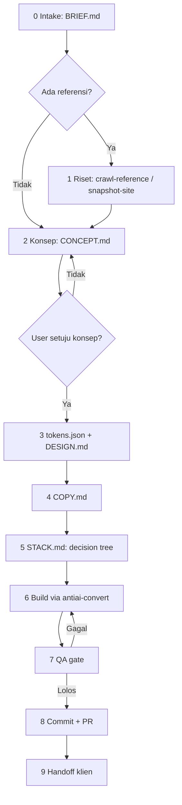
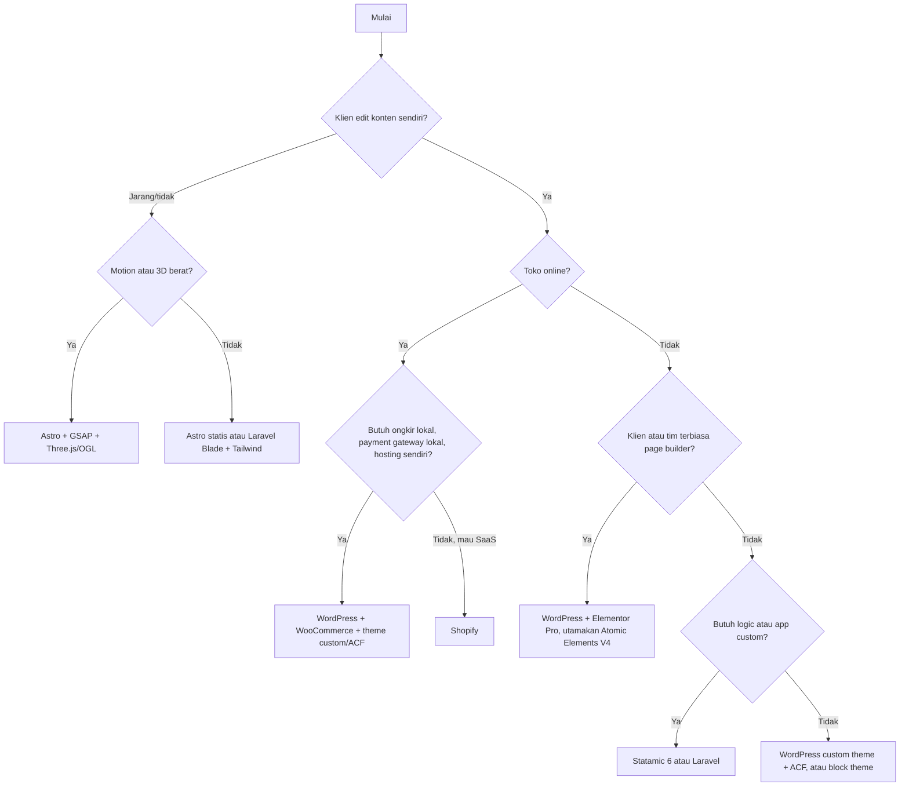

# Riset Tahap 1: Fondasi `agentic-weave` (Lintas Agent, Flow, Konversi, Design Token)

> Versi web search. Bagian yang tumpang tindih sudah digantikan `2026-10-29-04-tahap-1-deep.md` (mode Research, cakupan agent lebih lengkap).

Tanggal riset: 29 Oktober 2026. Basis repo: `cendysaputra/agentic-weave` commit `ebe7cfe`.

Tahap 1 fokus ke fondasi yang menentukan bentuk semua skill berikutnya: di mana skill dibaca oleh tiap agent, bagaimana flow kerja diatur, bagaimana hasil ATM dikonversi ke stack yang kamu pakai, dan format design token sebagai jembatan antar tahap. Coding, message, dan perluasan ATM masuk Tahap 2.

**Label:**
- **FAKTA**: diverifikasi dari dokumentasi resmi di sesi ini, sumber dicantumkan.
- **REKOMENDASI**: desain usulan, bukan fakta.
- **BELUM DIVERIFIKASI**: pengetahuan umum yang belum dicek ulang di sesi ini.

> File ini sengaja ditulis tanpa em dash, mengikuti R-02 di `antiai-core`.

## Daftar Isi

1. [Koreksi atas gap analysis sebelumnya](#1-koreksi-atas-gap-analysis-sebelumnya)
2. [Matriks kompatibilitas agent](#2-matriks-kompatibilitas-agent)
3. [AGENTS.md dan distribusi](#3-agentsmd-dan-distribusi)
4. [Pola flow multi-tahap yang terbukti](#4-pola-flow-multi-tahap-yang-terbukti)
5. [Rancangan `antiai-flow`](#5-rancangan-antiai-flow)
6. [Design token sebagai jembatan](#6-design-token-sebagai-jembatan)
7. [Target konversi: WordPress, Elementor, Statamic, Tailwind](#7-target-konversi-wordpress-elementor-statamic-tailwind)
8. [Rekaman motion untuk ATM](#8-rekaman-motion-untuk-atm)
9. [Rencana file konkret](#9-rencana-file-konkret)
10. [Agenda Tahap 2 dan Tahap 3](#10-agenda-tahap-2-dan-tahap-3)
11. [Sumber](#11-sumber)

---

## 1. Koreksi atas gap analysis sebelumnya

Dua poin di `GAP-ANALYSIS.md` ternyata keliru setelah dicek ke dokumentasi resmi:

| Poin lama | Status sebenarnya | Dampak |
|---|---|---|
| "README mengklaim Cursor membaca `.agents/skills`, perlu verifikasi" | **Klaim README kamu benar.** Cursor memuat skill dari `.agents/skills/` dan `~/.agents/skills/`, plus `.claude/skills/` dan `.codex/skills/` untuk kompatibilitas (FAKTA, docs Cursor) | Tidak perlu adapter `.cursor/rules` hanya untuk memuat skill |
| "Gemini CLI membaca `GEMINI.md`" sebagai target utama | Gemini CLI berhenti melayani pengguna konsumen per **18 Juni 2026** dan digantikan **Antigravity CLI** (FAKTA, Google Developers Blog) | Target yang relevan sekarang Antigravity, bukan Gemini CLI |

Kesimpulannya: target `agents` di installer kamu sudah menjangkau lebih banyak agent dari yang aku kira. Gap distribusi yang tersisa jauh lebih kecil (lihat bagian 2).

---

## 2. Matriks kompatibilitas agent

### 2.1 Tabel (FAKTA, kecuali ditandai)

| Agent | Path proyek | Path global | Baca `.agents/skills`? | Baca `AGENTS.md`? | Catatan |
|---|---|---|---|---|---|
| **Claude Code** | `.claude/skills/` | `~/.claude/skills/` | BELUM DIVERIFIKASI | BELUM DIVERIFIKASI | Juga lewat plugin marketplace (bagian 3.3) |
| **OpenAI Codex** | `.agents/skills/` di CWD, folder induk, sampai root repo | `~/.agents/skills/` | Ya (native) | Ya | Admin: `/etc/codex/skills`. Daftar skill awal dibatasi 2% context window atau 8.000 karakter. Deskripsi dipendekkan dulu kalau skill terlalu banyak |
| **Cursor** | `.agents/skills/`, `.cursor/skills/`, juga nested di subfolder | `~/.agents/skills/`, `~/.cursor/skills/` | Ya | Ya | Juga membaca `.claude/skills/` dan `.codex/skills/`. Skill di `~/.agents/skills/` **tidak** ikut ke Cloud Agents, hanya `~/.cursor/skills/` yang bisa disinkron |
| **GitHub Copilot CLI** | `.github/skills/`, `.claude/skills/`, `.agents/skills/` | `~/.copilot/skills/`, `~/.agents/skills/` | Ya | Ya | Path cloud agent belum terkonfirmasi di halaman yang dibaca |
| **Antigravity** (CLI, App, IDE) | `.agents/skills/` (masih kompatibel dengan `.agent/skills/`) | CLI: `~/.gemini/antigravity-cli/skills/`. App/IDE: `~/.gemini/config/skills/` | Ya, di level proyek | Tidak disebut | **Global tidak di `~/.agents/skills/`.** `name` opsional (fallback ke nama folder) |
| **Gemini CLI** (legacy) | `.gemini/skills/`, `.agents/skills/` | `~/.gemini/skills/`, `~/.agents/skills/` | Ya, dan `.agents` menang atas `.gemini` | Ya | Hanya untuk enterprise dan pengguna API key setelah 18 Juni 2026 |
| **Hermes Agent** | Tidak disebut di docs | `~/.hermes/skills/` | **Tidak secara default.** Harus ditambah lewat `skills.external_dirs` di `~/.hermes/config.yaml` | BELUM DIVERIFIKASI | Install: `hermes skills install <repo/path>` atau URL `SKILL.md` langsung. Ada security scan per install |
| **Grok Build** | Tidak disebut | Tidak disebut | BELUM DIVERIFIKASI | Ya | Pengumuman xAI (25 Mei 2026, beta): AGENTS.md, plugin, hooks, skills, dan MCP "work out of the box". Path tidak didokumentasikan di halaman itu |
| Windsurf, Amp, opencode, Zed, Junie, Devin | BELUM DIVERIFIKASI | BELUM DIVERIFIKASI | BELUM DIVERIFIKASI | Ya (terdaftar di agents.md) | |

### 2.2 Implikasi untuk installer kamu (REKOMENDASI)

Target `agents` (`.agents/skills`) sekarang menjangkau Codex, Cursor, Copilot, Antigravity (proyek), dan Gemini CLI. Yang masih bolong:

| Target baru | Path | Prioritas |
|---|---|---|
| `antigravity` (global) | `~/.gemini/antigravity-cli/skills/` dan `~/.gemini/config/skills/` | Tinggi. Instal proyek sudah tercakup, instal global belum |
| `hermes` | `~/.hermes/skills/`, atau tulis entri `external_dirs` ke `~/.hermes/config.yaml` yang menunjuk ke `~/.agents/skills` | Sedang. Opsi kedua lebih rapi karena satu sumber |
| `cursor-cloud` | `~/.cursor/skills/` | Rendah. Hanya kalau kamu pakai Cursor Cloud Agents |

### 2.3 Frontmatter lintas agent (FAKTA + REKOMENDASI)

Field yang **aman di semua agent**: `name` dan `description`. Field lain bersifat per-agent:

| Field | Didukung | Perilaku di agent lain |
|---|---|---|
| `license` | agentskills.io, Copilot | Diabaikan |
| `metadata` | agentskills.io, Cursor, Hermes (`metadata.hermes.*`) | Diabaikan |
| `allowed-tools` | agentskills.io (eksperimental), Copilot | Diabaikan. Copilot memperingatkan agar tidak pre-approve `shell`/`bash` |
| `paths` | Cursor (glob, membatasi kapan skill muncul) | Diabaikan |
| `disable-model-invocation` | Cursor | Diabaikan |
| `agents/openai.yaml` | Codex (`policy.allow_implicit_invocation`, `dependencies.tools`, UI) | File terpisah, aman |

**REKOMENDASI:**
- Pertahankan frontmatter minimal (`name` + `description`) di `SKILL.md`. Tambahkan `metadata` untuk versi.
- **Persempit `description` `antiai-ui` (903 karakter).** Codex memotong deskripsi saat budget daftar skill penuh, dan 12 skill kamu ditambah skill lain milik user bisa menyentuh batas 8.000 karakter. Deskripsi yang padat lebih aman: apa, kapan, dan kata kunci pemicu.
- Untuk skill seperti `antiai-convert` yang hanya relevan di proyek tertentu, `paths` di Cursor berguna (misalnya `**/*.php`, `**/theme.json`).

---

## 3. AGENTS.md dan distribusi

### 3.1 Isi AGENTS.md (FAKTA, agents.md)

Bagian yang disarankan: ringkasan proyek, perintah build dan test, gaya kode, instruksi testing, pertimbangan keamanan, plus opsional panduan commit/PR dan deployment. Di monorepo, AGENTS.md bersarang dibaca dari yang **terdekat** dengan file yang dikerjakan. Prompt user di chat selalu menang atas AGENTS.md.

### 3.2 Dua jenis AGENTS.md yang kamu butuhkan (REKOMENDASI)

**A. AGENTS.md untuk repo `agentic-weave` sendiri** (untuk agent yang mengembangkan skill ini):
- Struktur skill, aturan rule ID (jangan renumber), format Tell/Why/Fix
- Cara menjalankan skrip dan validasi (`skills-ref validate`)
- Dogfood: setiap perubahan teks harus lolos Delivery Gate

**B. Snippet AGENTS.md untuk proyek pengguna** (dipasang installer, opsional). Pola yang sama dipakai `miqdadbadjuber/anti-slop` dengan blok penanda:

```md
<!-- antiai:start -->
## Anti-slop

Untuk UI, copy, docs, commit, PR, error, atau pesan, muat `antiai-core` lalu skill yang sesuai.
Untuk proyek website dari brief sampai handoff, ikuti `antiai-flow`.
Jangan commit folder `atm/` atau `reference-crawl/`.
<!-- antiai:end -->
```

Penanda memungkinkan installer memperbarui blok tanpa menyentuh isi AGENTS.md lain milik proyek.

### 3.3 Claude Code plugin marketplace (FAKTA)

- Repo menjadi marketplace dengan file `.claude-plugin/marketplace.json`.
- Plugin punya manifest opsional `.claude-plugin/plugin.json` (hanya `name` wajib). Skill tetap di folder `skills/` di root plugin.
- Kalau `version` tidak diisi, commit SHA dipakai sebagai versi.
- User memasang dengan `/plugin marketplace add cendysaputra/agentic-weave` lalu `/plugin install <nama>@<marketplace>`.

**REKOMENDASI:** tambahkan `.claude-plugin/` ke repo. Ini jalur ketiga di samping npm dan `npx skills add`, dan memberi update otomatis untuk pengguna Claude Code. Struktur `skills/` kamu tidak perlu diubah.

---

## 4. Pola flow multi-tahap yang terbukti

### 4.1 Superpowers (obra) (FAKTA)

Tahapan: brainstorming → git worktree → writing plans → implementation (subagent atau batch dengan checkpoint tiap 3 tugas) → TDD → code review → finishing branch.

Mekanisme yang membuat urutan ditaati:
- **Larangan eksplisit:** tidak boleh ada kode sebelum desain disetujui
- **Artefak per tahap:** desain disimpan ke `docs/plans/YYYY-MM-DD-<topic>-design.md` dan di-commit
- **Verifikasi wajib:** test harus terlihat gagal dulu sebelum implementasi
- **Urutan review tetap:** spec compliance dulu, baru code quality
- **Handoff eksplisit:** setiap skill menyebut skill berikutnya, persetujuan user jadi checkpoint

### 4.2 GitHub spec-kit (FAKTA)

| Tahap | Artefak |
|---|---|
| Constitution | `.specify/memory/constitution.md` (prinsip, batasan, quality gate) |
| Specify | `specs/<fitur>/spec.md` |
| Clarify | Opsional |
| Plan | `specs/<fitur>/plan.md` + `research.md`, `data-model.md`, `quickstart.md`, `contracts/` |
| Tasks | `specs/<fitur>/tasks.md` |
| Implement | Dari tasks |
| Analyze | Opsional, cek plan terhadap requirement dan constitution |

### 4.3 Pelajaran untuk `antiai-flow` (REKOMENDASI)

1. **Artefak file, bukan ingatan.** Tiap tahap menulis file yang dibaca tahap berikutnya. Ini yang membuat flow jalan lintas agent dan lintas sesi: agent yang berbeda bisa melanjutkan karena status ada di disk.
2. **Gate yang bisa diperiksa.** Gate berupa skrip dengan exit code (seperti `compare-build --mode modifikasi` yang sudah kamu punya) lebih kuat dari "pastikan...".
3. **Larangan maju tanpa artefak.** "Jangan menulis markup sebelum `CONCEPT.md` ada dan disetujui" meniru gate Superpowers.
4. **Constitution = `antiai-core`.** Kamu sudah punya padanan constitution: rule R/C dan Delivery Gate. Flow tinggal merujuknya.
5. **Mode kerja eksplisit.** Tidak semua tugas butuh flow penuh. Revisi copy satu paragraf cukup `antiai-core` + skill copy.

---

## 5. Rancangan `antiai-flow`

### 5.1 Tahapan dan artefak (REKOMENDASI)

Semua artefak di folder `.antiai/` di root proyek klien. Folder ini **boleh** di-commit (berbeda dengan `atm/`), karena isinya keputusan proyek, bukan salinan situs orang.

| # | Tahap | Skill yang dimuat | Artefak keluar | Gate untuk lanjut |
|---|---|---|---|---|
| 0 | Intake | `antiai-flow` | `.antiai/BRIEF.md` | Audiens, tujuan, satu hal yang harus diingat, stack klien, siapa yang mengedit konten, tenggat. Kolom kosong ditandai `[TBD]`, tidak diisi tebakan (R-38) |
| 1 | Riset | `antiai-ui` | `reference-crawl/`, opsional `atm/` | Report crawl ada untuk tiap referensi. `atm/` dan `reference-crawl/` ada di `.gitignore` |
| 2 | Konsep | `antiai-ui` | `.antiai/CONCEPT.md` | Satu kalimat konsep + signature moment + anti-referensi. **Disetujui user** |
| 3 | Design token | `antiai-ui` | `.antiai/tokens.json` + `.antiai/DESIGN.md` | Setiap token punya alasan satu kalimat yang merujuk ke konsep (R-40) |
| 4 | Copy | `antiai-copywriting-id` atau copy EN | `.antiai/COPY.md` | Delivery Gate + checklist copy. Data yang hilang ditandai |
| 5 | Stack | `antiai-flow` (decision tree) | `.antiai/STACK.md` | Pilihan stack + alasan + library dari `libraries.md` |
| 6 | Build | `antiai-convert` + skill target | Kode proyek | Build jalan, tidak ada request ke host referensi |
| 7 | QA | Semua skill terkait | `.antiai/QA.md` | Lihat 5.2 |
| 8 | Rilis | `antiai-commit`, `antiai-pr` | Commit, PR | Checklist commit dan PR |
| 9 | Handoff | `antiai-email` / message (Tahap 2) | Pesan ke klien | Delivery Gate |

### 5.2 Gate QA tahap 7 (REKOMENDASI)

| Cek | Alat | Lolos jika |
|---|---|---|
| Originalitas | `compare-build.mjs --mode modifikasi` (kalau ATM dipakai) | Exit code 0 |
| Kesesuaian konversi | `compare-build.mjs --mode tiru` antara build statis dan build framework | Layout similarity sesuai target yang ditulis di `STACK.md` |
| Slop teks | `lint-text.mjs` (Tahap 2) | 0 temuan wajib |
| Rubrik | Self-score `antiai-ui` | Ditulis di `QA.md` dengan 3 perbaikan teratas |
| Performa | Lighthouse / Chrome DevTools MCP | Core Web Vitals "good" di HP throttled (C-6) |
| Aksesibilitas | axe + cek keyboard | WCAG AA (R-42) |

### 5.3 Mode kerja (REKOMENDASI)

| Mode | Kapan | Tahap yang dijalankan |
|---|---|---|
| `audit` | User minta review halaman atau teks yang sudah ada | 7 saja, tanpa mengubah file |
| `rewrite` | Revisi copy atau komponen tertentu | 4 atau 6 + 7 |
| `atm` | Studi dari referensi tanpa proyek penuh | 1 → 2 → 3 |
| `build` | Proyek baru dari brief | 0 → 9 |

Kalau user tidak menyebut mode, agent memilih dari isi permintaan dan menulis pilihannya di baris pertama jawaban.

### 5.4 Diagram



### 5.5 Decision tree stack (REKOMENDASI, disesuaikan untuk agency Indonesia)



---

## 6. Design token sebagai jembatan

### 6.1 Standar W3C (FAKTA)

- Design Tokens Community Group merilis versi stabil pertama **2025.10** pada 28 Oktober 2025.
- Implementasi referensi: Style Dictionary, Tokens Studio, Terrazzo. Didukung juga oleh Penpot, Figma, Sketch, Framer, dan lainnya.
- Spesifikasi lengkap: designtokens.org/tr/2025.10/. Detail sintaks (`$value`, `$type`, alias) **BELUM DIVERIFIKASI** di sesi ini, baca spesifikasinya sebelum menulis skema.

### 6.2 Kenapa format ini cocok untuk `agentic-weave` (REKOMENDASI)

Satu `tokens.json` berformat W3C bisa diubah Style Dictionary ke banyak target sekaligus. Jadi `crawl-reference.mjs` cukup menulis satu format, dan tiap target konversi membaca file yang sama:

```
reference-crawl/report.json  ──(studi, bukan disalin)──►  .antiai/tokens.json (W3C 2025.10)
                                                                 │
              ┌──────────────┬──────────────┬──────────────┬─────┴────────┐
              ▼              ▼              ▼              ▼              ▼
     Tailwind @theme   CSS variables   theme.json v3   Elementor V4    Statamic/Laravel
                                                       Variables       (CSS vars + Tailwind)
```

Catatan penting dari R-40 dan R-43: token di `report.json` adalah milik referensi. `tokens.json` proyek harus berisi keputusan baru yang diturunkan dari `CONCEPT.md`. Skrip boleh membantu membuat **draf** token dari referensi untuk mode `atm`, tapi untuk mode `build` setiap token wajib punya alasan dari konsep proyek.

### 6.3 Template `DESIGN.md` (REKOMENDASI)

```md
# Design: <nama proyek>

Konsep: <satu kalimat dari CONCEPT.md>

## Tipografi
| Peran | Font | Alasan |
| Display | ... | ... |
| Text | ... | ... |
Skala: clamp() per level, tracking dan line-height per ukuran.

## Warna
| Token | Nilai (OKLCH) | Peran | Alasan |

## Spacing, radius, elevasi
Basis spacing, radius (tajam / lembut / tanpa), kebijakan shadow.

## Motion
| Token | Easing | Durasi | Dipakai untuk |
Signature moment: pemicu, timing, versi mobile, versi reduced motion.

## Anti-referensi
Hal yang sengaja dihindari dan alasannya.
```

---

## 7. Target konversi: WordPress, Elementor, Statamic, Tailwind

### 7.1 Tailwind CSS v4 (FAKTA)

- Docs resmi saat ini menampilkan **Tailwind CSS v4.3**.
- Konfigurasi berbasis CSS lewat `@theme`. Variabel di `@theme` menghasilkan utility class sekaligus CSS variable.
- Namespace: `--color-*`, `--font-*`, `--text-*` (plus `--text-*--line-height`), `--spacing` (satu nilai menggerakkan seluruh skala), `--radius-*`, `--shadow-*`, `--ease-*`, `--breakpoint-*`.
- Reset default: `--color-*: initial;` menghapus semua warna bawaan. `--*: initial;` menghapus seluruh tema bawaan.
- `@theme` harus di top-level. Pakai `:root` untuk variabel yang tidak perlu utility.

**REKOMENDASI anti-slop khusus Tailwind** (masuk `libraries.md` dan `antiai-ui`):
- Mulai proyek dengan `--color-*: initial;` supaya palet default (termasuk indigo/violet yang jadi sumber "purple gradient") tidak tersedia sama sekali. Agent tidak bisa memakai `bg-indigo-500` kalau class itu tidak ada.
- Pertimbangkan reset `--radius-*` dan `--shadow-*` juga, lalu definisikan dari `tokens.json`. Ini menutup tell `rounded-2xl shadow-lg` di level konfigurasi, bukan sekadar larangan di prompt.
- Ini contoh kuat prinsip "gate deterministik lebih baik dari instruksi".

```css
@import "tailwindcss";

@theme {
  --color-*: initial;
  --radius-*: initial;
  --shadow-*: initial;

  /* Diisi dari .antiai/tokens.json, setiap nilai punya alasan di DESIGN.md */
  --color-ink: oklch(0.21 0.02 60);
  --color-paper: oklch(0.97 0.01 85);
  --color-accent: oklch(0.62 0.17 35);
  --font-display: "Nama Display", serif;
  --font-text: "Nama Text", sans-serif;
  --radius-sm: 2px;
  --shadow-lift: 0 1px 0 oklch(0.21 0.02 60 / 0.12);
  --ease-out-soft: cubic-bezier(0.22, 1, 0.36, 1);
}
```

Nilai di atas hanya contoh bentuk, bukan rekomendasi palet.

### 7.2 Elementor (FAKTA)

**Versi 4 (Atomic Editor):**
- Sejak April 2026 semua situs Elementor baru memakai V4 secara default. Halaman FAQ resmi menampilkan versi 4.3.5.
- **Atomic Elements**: markup berbasis tag HTML biasa tanpa lapisan wrapper tambahan. Mendukung **Classes, Variables, Interactions, dan Components**.
- Classes dan Variables bisa ikut diekspor/impor bersama situs atau template.
- V4 bisa menyinkronkan Color Variables dan Typography Classes ke Global Colors dan Fonts V3. Widget V3 lain tidak bisa memakai Classes/Variables secara langsung.
- Widget V3 tetap jalan dan bisa dicampur di halaman yang sama.
- Situs lama harus mengaktifkan fitur Atomic secara manual. Grid dan Loop belum tersedia sebagai Atomic Element.
- Peningkatan performa tergantung seberapa banyak halaman memakai Atomic Elements.

**Struktur data JSON:**
- Top-level template: `title`, `type` (page, header, footer, popup, error-404, dll.), `version` (terbaru `0.4`), `page_settings`, `content`.
- Tiap elemen: `id`, `elType` (mis. `container`), `isInner`, `settings`, `elements` (anak). Widget memakai `widgetType` (BELUM DIVERIFIKASI di halaman yang dibaca, dokumentasinya ada di halaman Widget Element).
- Ada dokumentasi terpisah untuk struktur data **Atomic Widgets**.

**Impor lewat WP-CLI:**
```bash
wp elementor library import path/to/template.json --returnType=ids
```

**REKOMENDASI untuk `references/elementor.md`:**
1. Untuk proyek baru, utamakan Atomic Elements + Variables + Classes. Ini padanan langsung `tokens.json` → Variables, dan menghindari markup wrapper berlapis yang memperberat performa.
2. Petakan token: warna dan tipografi ke Variables/Classes V4 (otomatis tersinkron ke Global V3 untuk widget lama).
3. Agent bisa menghasilkan template sebagai **JSON yang divalidasi** lalu diimpor dengan WP-CLI, daripada mengklik editor. Ini yang membuat alur Elementor bisa diotomasi. Validasi skema JSON dan uji impor di situs staging sebelum produksi.
4. GSAP/Lenis lewat Custom Code Elementor, dengan reduced motion dan cleanup. Detail integrasinya masuk Tahap 2 karena perlu diuji.
5. Riset lanjutan yang dibutuhkan: skema Atomic Widgets, cara Interactions V4 dibandingkan GSAP, dan Grid/Loop saat sudah atomic.

### 7.3 WordPress block theme dan `theme.json` (FAKTA sebagian)

- `theme.json` versi 3 adalah spesifikasi terbaru ("living specification" di developer.wordpress.org). Versi 3 diperkenalkan Juni 2024.
- Detail perubahan di WordPress 6.9 **BELUM DIVERIFIKASI** di sesi ini.

**REKOMENDASI:** `tokens.json` → `settings.color.palette`, `settings.typography.fontFamilies` dan `fontSizes` (fluid), `settings.spacing.spacingSizes`, `settings.custom` untuk easing/durasi. `theme.json` juga bisa dipakai di theme klasik untuk mengunci palet editor.

### 7.4 WordPress klasik + ACF, WooCommerce (BELUM DIVERIFIKASI di sesi ini)

Pola yang sudah umum dan akan diverifikasi di Tahap 2 bersama contoh kode dari repo `wp-code` kamu:
- `template-parts/sections/<nama>.php` per section, dipanggil dari ACF Flexible Content layout dengan nama yang sama
- Escaping output: `esc_html`, `esc_attr`, `esc_url`, `wp_kses_post`
- Enqueue GSAP/Lenis dengan `wp_enqueue_script` dan strategi `defer`
- WooCommerce: utamakan hooks dibanding override template penuh. Status cart/checkout berbasis block dan HPOS perlu dicek

### 7.5 Statamic 6 (FAKTA sebagian)

- Statamic 6 rilis **28 Januari 2026**. Control Panel ditulis ulang dengan Vue 3, Inertia.js, dan Tailwind 4. Ada tema CP dan command palette.
- Antlers mendapat sintaks component tag.
- Publish form dirombak, ada section yang bisa dilipat dan preview gambar untuk set Replicator dan Bard.
- Ada "Laravel Boost Guidelines" (detail BELUM DIVERIFIKASI). Ini relevan karena berarti Statamic sudah menyiapkan panduan untuk AI agent.

**REKOMENDASI untuk `references/statamic.md`:** section halaman = set Replicator atau Bard, field per set = fieldset yang dipakai ulang, template per set di `resources/views/sets/<nama>`. Karena CP Statamic 6 memakai Tailwind 4, token proyek bisa memakai pipeline `@theme` yang sama dengan frontend.

### 7.6 Strategi konversi umum (REKOMENDASI)

1. **Normalisasi**: build statis hasil Tiru dibersihkan dulu (tanpa script tracking, style inline dipindah ke token).
2. **Segmentasi**: satu section = satu komponen/partial/set/layout dengan nama semantik.
3. **Pisahkan data dari presentasi**: teks dan gambar menjadi field (ACF, blueprint, props, Elementor dynamic tags).
4. **Token dari satu sumber**: `tokens.json` di-generate ke format target, tidak ditulis ulang manual.
5. **Motion terpisah**: modul sendiri dengan cleanup dan reduced motion.
6. **Verifikasi**: `compare-build.mjs --mode tiru` membandingkan build statis vs hasil konversi yang jalan di `localhost`. Skrip kamu sudah menerima URL, jadi ini bisa langsung dipakai tanpa skrip baru.

---

## 8. Rekaman motion untuk ATM

**FAKTA (Playwright API):** `browser.newContext({ recordVideo: { dir, size } })` merekam semua halaman dalam context. Video baru tersimpan setelah `await context.close()`. Tanpa `size`, ukuran mengikuti viewport yang diperkecil agar muat di 800x800.

**REKOMENDASI untuk `snapshot-site.mjs --video`:**
- Set `size` sama dengan viewport (1440x900 desktop, 390x844 mobile), karena default 800x800 terlalu kecil untuk mempelajari detail tipografi.
- Rekam scroll bertahap dengan jeda tetap supaya timeline ScrollTrigger terlihat. Fungsi `scrollThrough` di `lib.mjs` bisa dipakai ulang.
- Rekam dua kali: dengan `reducedMotion: 'no-preference'` dan `'reduce'`, untuk melihat apakah referensi punya versi reduced motion.
- Video disimpan di `atm/<host>/<page>/video/`, ikut aturan `.gitignore` yang sama.

---

## 9. Rencana file konkret

Urutan pengerjaan dibuat supaya setiap langkah bisa di-merge sendiri tanpa merusak yang sudah ada.

### Langkah 1: kebersihan dan pintu masuk (kecil, cepat)

| File | Isi |
|---|---|
| `.gitignore` | `node_modules/`, `atm/`, `reference-crawl/` |
| `LICENSE` | Pilih lisensi. Tanpa lisensi, paket npm kamu secara hukum tidak boleh dipakai ulang |
| `CHANGELOG.md` | Mulai dari 1.0.0, ikuti `antiai-changelog` (dogfood) |
| `AGENTS.md` | Versi A di bagian 3.2 |
| `skills/antiai-ui/SKILL.md` | Pangkas `description` dari 903 karakter |

### Langkah 2: distribusi

| File | Isi |
|---|---|
| `bin/anti-ai.mjs` | Target `antigravity` (global) dan `hermes` (atau tulis `external_dirs`). Opsi `--agents-md` untuk menyisipkan blok `<!-- antiai:start -->` |
| `.claude-plugin/marketplace.json`, `.claude-plugin/plugin.json` | Jalur install Claude Code |
| `README.md` | Tabel agent yang didukung, sesuai bagian 2.1 |

### Langkah 3: `antiai-flow`

```
skills/antiai-flow/
├── SKILL.md                    # tahapan, mode kerja, gate, larangan maju tanpa artefak
├── references/
│   ├── stack-decision.md       # decision tree 5.5 + alasan tiap cabang
│   └── qa-gate.md              # tabel 5.2 + cara menjalankan tiap cek
└── assets/
    ├── BRIEF.template.md
    ├── CONCEPT.template.md
    ├── DESIGN.template.md
    ├── STACK.template.md
    └── QA.template.md
```

### Langkah 4: token

| File | Isi |
|---|---|
| `skills/antiai-ui/scripts/crawl-reference.mjs` | Opsi `--tokens` menulis draf `tokens.json` (W3C 2025.10) dari pengukuran, ditandai sebagai milik referensi |
| `skills/antiai-ui/scripts/build-tokens.mjs` | `tokens.json` → Tailwind `@theme`, CSS variables, `theme.json`. Pertimbangkan Style Dictionary daripada menulis converter sendiri |
| `skills/antiai-ui/references/libraries.md` | Bagian "Styling": Tailwind v4.3, pola reset `initial` di 7.1 |

### Langkah 5: `antiai-convert`

```
skills/antiai-convert/
├── SKILL.md                    # strategi 7.6, verifikasi pakai compare-build --mode tiru
└── references/
    ├── tailwind.md
    ├── wordpress-classic.md    # ACF Flexible Content, escaping, enqueue (verifikasi Tahap 2)
    ├── wordpress-block.md      # theme.json v3
    ├── elementor.md            # V4 Atomic, Variables/Classes, JSON + wp elementor library import
    ├── woocommerce.md          # hooks vs override (verifikasi Tahap 2)
    ├── statamic.md             # Statamic 6, Replicator/Bard sets
    ├── laravel-blade.md
    ├── astro.md
    └── react-next.md
```

Kerjakan reference sesuai urutan stack yang paling sering kamu pakai: Elementor, WordPress klasik, Statamic, baru sisanya.

### Langkah 6: rekaman motion

`snapshot-site.mjs --video` sesuai bagian 8.

---

## 10. Agenda Tahap 2 dan Tahap 3

### Tahap 2: kualitas eksekusi

- `antiai-code`: komentar, label TODO/FIXME/NOTE, over-engineering, defensive overdose, test slop (Code Slop, aislop, arXiv 2605.13280)
- Git: konvensi branch, push gate, kebijakan trailer `Co-Authored-By`, pilihan default antara `Fix:` dan Conventional Commits
- Message ke klien: WhatsApp, Slack, register Bapak/Ibu vs kamu, resolusi konflik dengan aturan "Register Mixing" di `copywriting-id`
- `lint-text.mjs` deterministik EN + ID, siap jadi pre-commit hook
- Verifikasi WordPress klasik, WooCommerce (HPOS, block checkout), integrasi GSAP/Lenis/Swup di WordPress dan Elementor (reinit setelah transisi)
- Skema Atomic Widgets Elementor dan Interactions V4
- Snapshot multi-halaman

### Tahap 3: pembuktian dan skala

- Eval: beberapa brief yang sama, dengan dan tanpa skill, diukur dengan `compare-build`, self-score, dan `lint-text`
- Copy marketing bahasa Inggris sebagai skill tersendiri
- Konversi ke Shopify, Webflow, Vue/Nuxt
- Uji lintas agent nyata: jalankan flow yang sama di Claude Code, Codex, Cursor, Antigravity, Hermes, Grok Build, catat perbedaan perilaku
- Pertimbangkan MCP server kecil untuk `agentic-weave` (crawl, lint, compare) supaya agent tanpa akses shell tetap bisa memakai skrip

---

## 11. Sumber

**Agent dan distribusi**
- Cursor Agent Skills: https://cursor.com/docs/skills
- Codex skills: https://developers.openai.com/codex/skills (dialihkan ke https://learn.chatgpt.com/docs/build-skills)
- Gemini CLI skills: https://geminicli.com/docs/cli/skills/
- Transisi Gemini CLI ke Antigravity CLI: https://developers.googleblog.com/an-important-update-transitioning-gemini-cli-to-antigravity-cli/
- Antigravity skills: https://antigravity.google/docs/skills
- GitHub Copilot CLI skills: https://docs.github.com/en/copilot/how-tos/copilot-cli/customize-copilot/create-skills
- Hermes Agent skills: https://github.com/NousResearch/hermes-agent/blob/main/website/docs/user-guide/features/skills.md
- Grok Build: https://x.ai/news/grok-build-cli
- AGENTS.md: https://agents.md/
- Claude Code plugin marketplace (ringkasan pihak ketiga): https://www.morphllm.com/claude-code-marketplace
- Spesifikasi Agent Skills: https://agentskills.io/specification

**Flow**
- Superpowers workflow: https://mintlify.com/obra/superpowers/concepts/workflow
- GitHub spec-kit (ringkasan): https://docs.plannotator.ai/frameworks/github-spec-kit

**Token dan styling**
- Design Tokens stabil 2025.10: https://www.w3.org/community/design-tokens/2025/10/28/design-tokens-specification-reaches-first-stable-version/
- Spesifikasi: https://www.designtokens.org/tr/2025.10/
- Tailwind `@theme`: https://tailwindcss.com/docs/theme

**Konversi**
- Elementor V4 FAQ: https://elementor.com/products/website-builder/v4-faq/
- Elementor data structure: https://developers.elementor.com/docs/data-structure/general-structure/
- Elementor Atomic Widgets data: https://developers.elementor.com/docs/data-structure/atomic-widgets/
- Elementor WP-CLI import: https://developers.elementor.com/docs/cli/library-import/
- theme.json v3: https://developer.wordpress.org/block-editor/reference-guides/theme-json-reference/theme-json-living/
- theme.json v3 pengumuman: https://make.wordpress.org/core/2024/06/19/theme-json-version-3/
- Statamic 6: https://statamic.com/blog/statamic-6

**ATM**
- Playwright `recordVideo`: https://playwright.dev/docs/api/class-browser#browser-new-context-option-record-video
- Playwright video: https://playwright.dev/docs/videos
