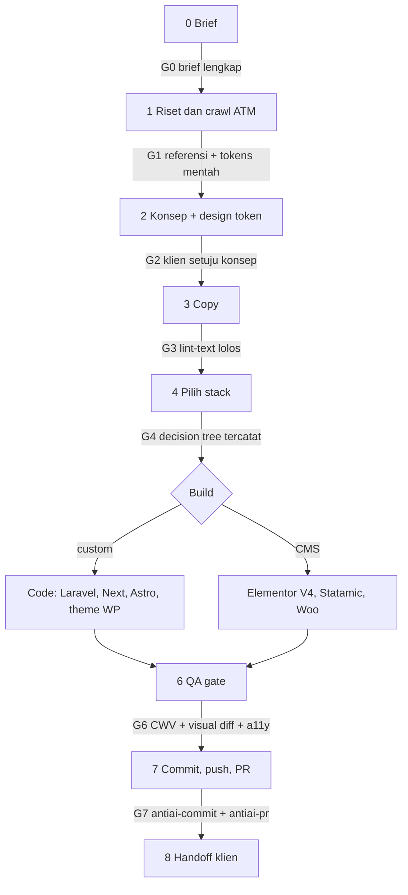

# agentic-weave Tahap 1: Riset Kompatibilitas Agent, Flow Agency, Konversi CMS, dan Design Token

> Sumber: laporan mode Research, 29 Oktober 2026. Laporan ini menggantikan `2026-10-29-03-tahap-1-websearch.md` di bagian yang tumpang tindih.

Kesimpulan utama: format SKILL.md sekarang sudah bisa dipakai lintas agent. Grok Build, OpenCode, Amp, Cline, Kiro, dan Windsurf/Devin Desktop punya path skill resmi yang terdokumentasi, dan beberapa di antaranya juga membaca `.claude/skills` atau `~/.agents/skills`. Jadi prioritas anti-ai sekarang bukan menambah lebih banyak path installer. Yang perlu diprioritaskan adalah (1) memangkas description dan body skill agar lolos batas spesifikasi serta anggaran katalog, (2) menambah `AGENTS.md` dan plugin Claude Code yang bisa dipasang dari repo yang sama, lalu (3) membangun `antiai-flow` dan `antiai-convert` dengan artefak dan gate yang eksplisit.

## TL;DR

- **Distribusi:** pertahankan `skills/<name>/SKILL.md` sebagai sumber tunggal. Tambahkan `.claude-plugin/marketplace.json` (Claude Code sudah mendukung sumber plugin bertipe `npm`, jadi paket `anti-ai-skills` bisa langsung dipakai) dan `AGENTS.md`. Perluas installer ke `~/.grok/skills`, `~/.config/opencode/skills`, `~/.cline/skills`, `~/.kiro/skills`, `~/.codeium/windsurf/skills`, dan `~/.config/agents/skills` (Amp).
- **Kualitas skill:** riset arXiv 2607.01456 menemukan 26 jenis skill smell, rata-rata 10,5 smell per file, dan hanya 1 dari 238 file yang bersih. Riset arXiv 2608.11888 mencatat 307 kegagalan yang dipicu skill. Karena itu setiap skill agentic-weave perlu validator, eval, dan body di bawah 500 baris atau 5000 token, bukan hanya aturan yang makin panjang.
- **Flow dan konversi:** pakai pola superpowers dan spec-kit, yaitu artefak berupa file di `.antiai/`, gate persetujuan manusia, dan larangan maju sebelum gate lolos. Untuk Elementor V4, agent hanya boleh menghasilkan JSON atomic dengan elemen yang terdokumentasi (`e-div-block`, `e-flexbox`, `e-grid`, versi page `0.4`). Skema widget atomic lainnya wajib diambil dari ekspor template situs nyata, karena Elementor sendiri menyatakan API pembuatan elemen atomic belum dibuka.

## Daftar Isi

1. Legenda label
2. A. Kompatibilitas lintas agent dan distribusi
3. B. Skill flow dan orkestrasi
4. C. Konversi ATM ke framework dan CMS
5. D. Design token dari crawl
6. E. Alat crawl dan perekaman motion
7. Rencana file konkret
8. Urutan pengerjaan (merge bertahap)
9. Agenda Tahap 2 dan Tahap 3
10. Caveats

## 1. Legenda label

| Label | Arti |
|---|---|
| **FAKTA** | Dikonfirmasi dari dokumentasi resmi atau paper primer di riset tahap ini |
| **FAKTA (brief)** | Sudah terverifikasi di pencarian awal, tidak dikonfirmasi ulang di putaran ini |
| **REKOMENDASI** | Keputusan desain yang disarankan berdasarkan fakta di atas |
| **BELUM TERVERIFIKASI** | Hanya dari sumber sekunder atau belum dicari, jangan ditulis ke skill sebagai fakta |

## 2. A. Kompatibilitas lintas agent dan distribusi

### A1. Spesifikasi agentskills.io

**FAKTA:**

| Field | Wajib | Batas |
|---|---|---|
| `name` | Ya | Maks 64 karakter, huruf kecil, angka, tanda hubung; tidak boleh diawali atau diakhiri tanda hubung; harus sama dengan nama folder |
| `description` | Ya | Maks 1024 karakter, tidak kosong, menjelaskan apa dan kapan dipakai |
| `license` | Tidak | Nama lisensi atau rujukan file lisensi |
| `compatibility` | Tidak | Maks 500 karakter, kebutuhan lingkungan |
| `metadata` | Tidak | Map key-value bebas |
| `allowed-tools` | Tidak | String dipisah spasi, eksperimental |

- Progressive disclosure punya tiga tingkat: katalog (name + description) dimuat saat sesi mulai, body SKILL.md dimuat saat skill aktif (disarankan di bawah 5000 token), lalu file referensi dimuat saat dibutuhkan. Panduan integrasi agentskills.io menyebut katalog sekitar 50 sampai 100 token per skill.
- Rujukan file pakai path relatif dari root skill dan sebaiknya hanya satu tingkat di bawah SKILL.md.
- Validasi dilakukan dengan `skills-ref validate ./my-skill`.

**FAKTA:** Menurut dokumentasi resmi Codex, daftar skill memakai maksimal 2% context window model, atau 8.000 karakter bila ukuran context window tidak diketahui, dan Codex memendekkan description lebih dulu bila skill yang terpasang banyak. Batas ini bisa diubah lewat `skills.max_context_tokens`, maksimal 10.000 token.

**REKOMENDASI:**
- Description `antiai-ui` saat ini 903 karakter. Itu masih di bawah 1024, tapi kalau 12 skill masing-masing sepanjang itu, totalnya sekitar 10.800 karakter dan melewati anggaran 8.000 karakter Codex. Targetkan description di bawah 350 karakter per skill. Pola: "Lakukan X. Pakai saat Y, Z. Jangan pakai untuk W."
- Field khusus agent (misalnya `metadata.hermes`, `paths`, `disable-model-invocation`) hanya ditaruh di bawah `metadata` atau di field yang diabaikan secara aman. Grok, misalnya, menyatakan bahwa key tambahan diabaikan.
- Tambahkan `skills-ref validate` ke CI.

Sumber primer: https://agentskills.io/specification , https://agentskills.io/integrate-skills , https://github.com/agentskills/agentskills/blob/main/docs/specification.mdx

### A1b. Riset efektivitas skill

| Studi | Temuan kunci (FAKTA) | Implikasi untuk agentic-weave |
|---|---|---|
| arXiv 2607.01456 "From Anatomy to Smells" | 26 skill smell hasil tinjauan multivokal atas 29 sumber; 11 smell muncul di lebih dari 50% file; rata-rata 10,5 smell per file; hanya 1 dari 238 file yang bebas smell; smell jarang hilang saat skill berevolusi | Bangun `scripts/lint-skills.mjs` sejak awal; smell yang masuk sulit dibuang belakangan |
| arXiv 2608.11888 "Agent Skills Can Be Harmful" | 307 kegagalan yang dipicu skill (125 fungsional, 182 regresi efisiensi); kegagalan fungsional justru sering dipicu skill yang relevan; "Excessive Verification" mencakup 36,8% regresi efisiensi | Delivery Gate agentic-weave jangan menyuruh agent mengulang tes tanpa batas; tetapkan batas iterasi (misalnya maksimal 2 putaran compare-build) |
| arXiv 2610.08875 "Downstream Utility" | Diukur pada 87 tugas SkillsBench dan 232 skill, dengan 3 LLM dan 3 harness; utilitas dihitung sebagai selisih pass rate terhadap kondisi tanpa skill | Eval Tahap 3 harus membandingkan hasil dengan dan tanpa skill, bukan hanya mengecek skill itu terpicu |

Sumber primer: https://arxiv.org/abs/2607.01456 , https://arxiv.org/html/2607.01456v1 , https://arxiv.org/html/2608.11888v1 , https://arxiv.org/html/2610.08875

### A2. Matriks kompatibilitas agent

| Agent | Path proyek | Path global | SKILL.md native | Baca `.agents/skills` | Baca AGENTS.md | Field/catatan khusus | Status |
|---|---|---|---|---|---|---|---|
| Claude Code | `.claude/skills/` | `~/.claude/skills/` | Ya | BELUM TERVERIFIKASI | Ya sejak v2.1.277, default hanya bila tidak ada CLAUDE.md/CLAUDE.local.md | Plugin, marketplace, hooks; nama marketplace `skills-dir` dicadangkan untuk skill dari `.claude/skills/` | FAKTA |
| Grok Build | `./.grok/skills/` (dicari naik sampai root repo) | `~/.grok/skills/`, plus `~/.agents/skills/` | Ya | Global `~/.agents/skills/` ya | Ya (AGENTS.md, Agents.md, AGENT.md, dari cwd ke root repo) | `when-to-use`, `paths`, `argument-hint`, `user-invocable` (hanya literal `true`), `disable-model-invocation`, `metadata` (`author`, `short-description` ditampilkan di UI); membaca skill, plugin, hooks, dan CLAUDE.md milik Claude Code tanpa konfigurasi | FAKTA |
| Antigravity | `.agents/skills` | `~/.gemini/antigravity-cli/skills/` (CLI), `~/.gemini/config/skills/` (App/IDE) | Ya | Ya | AGENTS.md atau GEMINI.md | Menurut pengumuman tim Gemini CLI (GitHub Discussion #28017, 18 Juni 2026), Gemini CLI berhenti melayani akun Google AI Pro, AI Ultra, dan tier gratis individu, sedangkan lisensi Gemini Code Assist dan autentikasi API key tidak terdampak. Antigravity CLI menyalin Skills dari direktori Gemini CLI lokal saat instalasi | FAKTA |
| Codex | `.agents/skills` dari CWD sampai root | `~/.agents/skills`, `/etc/codex/skills` | Ya | Ya | Ya | `agents/openai.yaml`; katalog 2% atau 8.000 karakter | FAKTA (brief) |
| Cursor | `.agents/skills`, `.cursor/skills`, `.claude/skills`, `.codex/skills` | `~/.agents/skills` (tidak ikut ke Cloud Agents) | Ya | Ya | Ya | `paths`, `disable-model-invocation` | FAKTA (brief) |
| Copilot CLI | `.github/skills`, `.claude/skills`, `.agents/skills` | `~/.copilot/skills`, `~/.agents/skills` | Ya | Ya | Ya | | FAKTA (brief) |
| OpenCode | `.opencode/skills/`, `.claude/skills/`, `.agents/skills/` (naik sampai git worktree) | `~/.config/opencode/skills/`, `~/.claude/skills/`, `~/.agents/skills/` | Ya | Ya | BELUM TERVERIFIKASI di docs | Docs v2: naikkan `version` saat file berubah agar cache disegarkan; permission di `opencode.json` bisa menyembunyikan skill | FAKTA |
| Amp | `.agents/skills/` | `~/.config/agents/skills/`, `~/.agents/skills/`, `~/.config/amp/skills/`, `~/.claude/skills/` | Ya | Ya | Ya, fallback ke CLAUDE.md bila AGENTS.md tidak ada | Pencarian rekursif sampai 5 level; `amp.skills.path`; opsi menonaktifkan lokasi Claude/global | FAKTA |
| Windsurf (kini Devin Desktop) | `.devin/skills/` (utama), `.windsurf/skills/` (legacy, masih dibaca) | `~/.codeium/windsurf/skills/` atau `~/.config/devin/skills/` | Ya | BELUM TERVERIFIKASI | BELUM TERVERIFIKASI | Ada path sistem enterprise (`/etc/devin/skills/` dan lain-lain) | FAKTA |
| Cline | `.cline/skills/` (disarankan), `.clinerules/skills/`, `.claude/skills/` | `~/.cline/skills/` | Ya | BELUM TERVERIFIKASI | BELUM TERVERIFIKASI | Jika nama bentrok, skill global yang menang | FAKTA |
| Kiro | `.kiro/skills/` | `~/.kiro/skills/` | Ya | BELUM TERVERIFIKASI | BELUM TERVERIFIKASI | Custom agent butuh `"resources": ["skill://.kiro/skills/**/SKILL.md"]` | FAKTA |
| Junie | `.junie/skills/` | BELUM TERVERIFIKASI (sumber sekunder menyebut `~/.junie/skills/` dan `.agents/skills`) | Ya | BELUM TERVERIFIKASI | Ya, AGENTS.md jadi default guidelines, `.junie/guidelines.md` tetap didukung | | FAKTA sebagian |
| Hermes | BELUM TERVERIFIKASI untuk level proyek | `~/.hermes/skills/`, `external_dirs` di `~/.hermes/config.yaml` | Ya | Lewat `external_dirs` | BELUM TERVERIFIKASI | `metadata.hermes`, `hermes skills install` | FAKTA (brief) sebagian |
| Zed | BELUM TERVERIFIKASI | BELUM TERVERIFIKASI | BELUM TERVERIFIKASI | BELUM TERVERIFIKASI | Disebut membaca AGENTS.md oleh sumber sekunder | | BELUM TERVERIFIKASI |

**REKOMENDASI target installer (urut prioritas):**
1. `~/.agents/skills` (Codex, Cursor, Copilot, OpenCode, Amp, Grok).
2. `~/.claude/skills` (Claude Code, OpenCode, Amp, dan Grok lewat kompatibilitas Claude).
3. Target baru yang tidak tercakup dua path di atas: `~/.gemini/antigravity-cli/skills`, `~/.gemini/config/skills`, `~/.hermes/skills`, `~/.cline/skills`, `~/.kiro/skills`, `~/.codeium/windsurf/skills`.
4. Jangan menyalin ke `~/.grok/skills` dan `~/.config/opencode/skills` secara default, karena keduanya sudah membaca path di poin 1 dan 2. Salinan ganda berisiko memunculkan duplikat di katalog. Sediakan sebagai `--target grok` dan `--target opencode` opsional.

Sumber primer: https://docs.x.ai/build/features/skills-plugins-marketplaces , https://opencode.ai/docs/skills/ , https://opencode.ai/v2/docs/skills/ , https://ampcode.com/docs/customize/skills , https://ampcode.com/manual/switch-from , https://docs.windsurf.com/windsurf/cascade/skills , https://docs.cline.bot/customization/skills , https://kiro.dev/docs/skills/ , https://kiro.dev/docs/custom-agents/configuration-reference/ , https://plugins.jetbrains.com/plugin/26104-junie-the-ai-coding-agent-by-jetbrains , https://youtrack.jetbrains.com/projects/JUNIE/issues/JUNIE-618/Support-AGENTS.md

### A3. AGENTS.md

**FAKTA:**
- Untuk file bersarang, berlaku aturan agents.md: AGENTS.md terdekat dengan file yang diedit diutamakan, dan prompt eksplisit dari pengguna mengalahkan semuanya. Situs agents.md menyebut repo utama OpenAI punya 88 file AGENTS.md dan format ini dipakai lebih dari 60 ribu proyek open source.
- Di Claude Code (v2.1.277+), pengaturan default `claude-md-or-agents-md` membaca AGENTS.md hanya bila tidak ada CLAUDE.md, `.claude/CLAUDE.md`, atau CLAUDE.local.md di direktori kerja dan di atasnya. Opsi lainnya adalah `claude-md-and-agents-md`, `claude-md`, dan `managed-only`. CLAUDE.md yang berisi `@AGENTS.md` tidak akan membuat AGENTS.md terbaca dua kali.
- Grok Build membaca keluarga AGENTS.md dari cwd sampai root repo. Amp memakai AGENTS.md dan jatuh ke CLAUDE.md bila AGENTS.md tidak ada.
- Junie memakai AGENTS.md sebagai guidelines default. Jika ada `.junie/guidelines.md` lama, isi AGENTS.md diletakkan lebih dulu.

**REKOMENDASI isi AGENTS.md repo agentic-weave (target di bawah 120 baris):**
1. Perintah: `npm test`, `node bin/anti-ai.mjs --dry-run`, `skills-ref validate skills/*`.
2. Peta repo: `skills/`, `bin/`, `scripts/`, `.claude-plugin/`, `research/`.
3. Aturan menulis skill: format Tell/Why/Fix + Rule, rule ID stabil, tanpa em dash, description di bawah 350 karakter.
4. Penunjuk ke skill: "Untuk pekerjaan UI baca `skills/antiai-ui/SKILL.md`; untuk alur end-to-end mulai dari `skills/antiai-flow/SKILL.md`." Tulis sebagai path relatif, bukan sintaks import.
5. CLAUDE.md cukup satu baris `@AGENTS.md` ditambah catatan khusus Claude.

**REKOMENDASI pola blok penanda yang dikelola installer** (untuk AGENTS.md di proyek klien):

```md
<!-- agentic-weave:start v0.5.0 (dikelola anti-ai-skills, jangan edit manual) -->
## agentic-weave
- Sebelum menyerahkan teks, UI, commit, atau PR: jalankan Delivery Gate di skill antiai-core.
- Alur proyek web: ikuti skill antiai-flow, artefak di .antiai/.
<!-- agentic-weave:end -->
```

Installer hanya mengganti isi di antara penanda dan menyimpan versi di penanda pembuka. Ini **REKOMENDASI** dan bukan standar resmi.

Sumber primer: https://agents.md/ , https://code.claude.com/docs/en/memory , https://docs.x.ai/build/features/skills-plugins-marketplaces , https://ampcode.com/manual/switch-from , https://youtrack.jetbrains.com/projects/JUNIE/issues/JUNIE-618/Support-AGENTS.md

### A4. Distribusi

**FAKTA, marketplace Claude Code:**
- File berada di `.claude-plugin/marketplace.json`. Field wajib di tingkat atas adalah `name`, `owner` (dengan `owner.name` wajib), dan `plugins`. Field opsional: `$schema`, `description`, `version`, `metadata.pluginRoot`, `forceRemoveDeletedPlugins`, `allowCrossMarketplaceDependenciesOn`, dan `renames`.
- Setiap entri plugin wajib punya `name` dan `source`. Field opsional: `description`, `version` (jika `plugin.json` juga mengisi `version`, `plugin.json` yang dipakai), `category`, `tags`, `strict` (default `true`), `dependencies`, `defaultEnabled`, dan `displayName`.
- Tipe sumber plugin: path relatif (diawali `./`), `github`, `url`, `git-subdir`, `npm` (`package`, `version`, `registry`; diambil tanpa menjalankan install script), `archive`, dan `command`.
- Nama `agent-skills`, `anthropic-agent-skills`, `npm`, `github`, dan nama berawalan `claudeai-` termasuk yang dicadangkan.
- Key yang tidak dikenal diabaikan diam-diam, dan `claude plugin validate` melaporkannya sebagai peringatan.

**FAKTA:** Plugin Grok memuat skills, agents, hooks, MCP, dan LSP. Grok juga otomatis membaca marketplace dan plugin Claude Code.

**REKOMENDASI struktur:**

```json
{
  "name": "imajiner-agentic-weave",
  "owner": { "name": "Cendi Saputra", "url": "https://github.com/cendysaputra" },
  "description": "Skill anti-AI-slop untuk UI, copy ID, commit, PR, dan flow agency web",
  "plugins": [
    { "name": "agentic-weave", "source": "./", "description": "12+ skill agentic-weave", "category": "quality" }
  ]
}
```

Lalu `.claude-plugin/plugin.json` berisi `{ "name": "anti-ai", "version": "0.5.0", "description": "...", "license": "MIT" }`. Versi di `plugin.json`, `package.json`, dan penanda AGENTS.md disinkronkan oleh satu skrip `scripts/bump-version.mjs`. Nama marketplace `imajiner-agentic-weave` lebih aman daripada `anti-ai-skills`.

**BELUM TERVERIFIKASI:** detail CLI `npx skills add` dan skills.sh (flag `-a`, `-g`, lockfile). Sumber sekunder hanya menunjukkan pola `npx skills add owner/repo --skill nama` dan `--agent windsurf`.

Sumber primer: https://code.claude.com/docs/en/plugins/marketplace-reference , https://code.claude.com/docs/en/plugin-marketplaces , https://docs.x.ai/build/features/skills-plugins-marketplaces

### A5. Skill multi-file yang saling bergantung

**FAKTA:** Spesifikasi tidak punya mekanisme dependensi antar skill. Rujukan file hanya relatif dari root skill masing-masing dan disarankan satu tingkat. Marketplace Claude punya `dependencies` antar plugin, bukan antar skill.

**REKOMENDASI:**
1. Setiap sub-skill (misalnya `antiai-ui`) memuat ringkasan 10 sampai 15 baris berisi rule inti dari `antiai-core`, lalu menulis "Rule lengkap: baca skill antiai-core" sebagai instruksi teks, bukan path `../`. Path keluar dari root skill akan rusak saat skill disalin sendiri-sendiri.
2. Installer selalu memasang `antiai-core` bersama skill apa pun (dependensi keras di `bin/anti-ai.mjs`).
3. Untuk plugin Claude, satu plugin berisi semua skill sehingga dependensi selalu termuat.
4. Rule ID stabil (R-XX) menjadi kontrak: sub-skill hanya merujuk ID, tidak menyalin teks panjang.

## 3. B. Skill flow dan orkestrasi

### B1. Pola yang terbukti

| Sumber | Artefak | Gate | Larangan maju | Status |
|---|---|---|---|---|
| obra/superpowers | Design doc, lalu plan di `docs/superpowers/plans/` | Persetujuan desain, persetujuan plan | Setelah brainstorming, satu-satunya skill berikutnya adalah writing-plans; tidak boleh menulis kode sebelum desain disetujui | FAKTA |
| GitHub spec-kit | `.specify/memory/constitution.md`, `specs/###/spec.md`, `plan.md`, `tasks.md` | `/speckit.analyze` setelah tasks dan sebelum implement | Urutan constitution, specify, (clarify), plan, tasks, implement | FAKTA (dari dokumentasi pihak ketiga yang mengutip repo) |
| BMAD, Kiro specs, Impeccable, Anthropic skill-creator | | | | BELUM TERVERIFIKASI di tahap ini |

**FAKTA:** Larangan "tanpa kode sebelum desain disetujui" di superpowers hanyalah disiplin yang ditulis di skill dan sifatnya membujuk, bukan mengunci. Plan Mode Claude Code, sebaliknya, benar-benar menonaktifkan tool tulis. Satu tugas dalam plan superpowers berukuran 2 sampai 5 menit dan menyebut path file secara eksak.

**REKOMENDASI:** Gate agentic-weave harus bisa diverifikasi mesin, misalnya keberadaan file artefak dengan field wajib atau skor compare-build. Jangan hanya mengandalkan kalimat "jangan lanjut".

Sumber primer: https://github.com/obra/superpowers/blob/main/skills/brainstorming/SKILL.md , https://github.com/obra/superpowers/issues/512

### B2. Flow agency web (REKOMENDASI)



**Struktur `.antiai/`:**

| File | Tahap | Field wajib (kriteria lolos gate) |
|---|---|---|
| `.antiai/00-brief.md` | Brief | tujuan bisnis, audiens, 3 KPI, deadline, anggaran, CMS wajib atau bebas, bahasa (ID/EN) |
| `.antiai/01-research/refs.json` + `snapshots/` | Riset | minimal 3 referensi, masing-masing dengan URL, alasan, elemen yang ditiru (ATM: Amati, Tiru, Modifikasi) |
| `.antiai/02-concept.md` + `tokens.tokens.json` | Konsep | concept statement, signature moment, token valid DTCG |
| `.antiai/03-copy.md` | Copy | lolos `antiai-copywriting-id`, nol pelanggaran R-XX |
| `.antiai/04-stack.md` | Stack | jawaban decision tree + alasan |
| `.antiai/05-build-log.md` | Build | daftar section, file yang dibuat |
| `.antiai/06-qa.json` | QA | LCP di bawah 2,5 detik, CLS di bawah 0,1, INP di bawah 200 ms (target), skor compare-build, gate originalitas |
| `.antiai/07-handoff.md` | Handoff | kredensial (tidak di-commit), panduan edit konten, daftar plugin + lisensi |
| `.antiai/state.json` | Semua | `{ "stage": 3, "mode": "build", "gates": { "G0": "pass" } }` |

**Mode kerja:** `audit` (hanya membaca dan melapor), `rewrite` (mengubah teks atau UI yang ada), `atm` (tahap 1 sampai 2 saja), `build` (penuh). Skill flow membaca `state.json` dan menolak melompat tahap kecuali pengguna menulis "override G<n>", lalu override itu dicatat.

**Decision tree stack (REKOMENDASI untuk agency Indonesia):**

| Pertanyaan | Jika ya | Jika tidak |
|---|---|---|
| Klien harus edit layout sendiri secara visual? | WordPress + Elementor V4 | lanjut |
| Ada toko online dengan payment lokal (Midtrans/Xendit) dan stok? | WooCommerce (atau Shopify bila klien mau SaaS dan bayar USD) | lanjut |
| Konten terstruktur, klien hanya edit isi, tim kuat di Laravel? | Statamic 6 (flat-file, Blade/Antlers) | lanjut |
| Konten terstruktur, hosting shared murah, ekosistem plugin perlu? | WordPress custom theme + ACF Flexible Content | lanjut |
| Aplikasi dengan auth, dashboard, logika bisnis? | Laravel + Blade/Livewire | lanjut |
| Landing atau marketing statis dengan motion berat? | Astro (atau Next.js bila butuh React/R3F) | Webflow bila klien tim marketing non-dev |

## 4. C. Konversi ATM ke framework dan CMS

### C1. WordPress custom theme

**FAKTA:**
- Sejak WP 6.3, parameter kelima `wp_enqueue_script()` menerima array `$args` dengan `strategy` (`defer` atau `async`) dan `in_footer`.
- WP 6.9 menambahkan `fetchpriority` ke `$args`.
- `async` dieksekusi begitu selesai dimuat, jadi tidak cocok untuk skrip yang punya dependensi.

**REKOMENDASI pola enqueue GSAP + Lenis:**

```php
add_action( 'wp_enqueue_scripts', function () {
  $v = wp_get_theme()->get( 'Version' );
  wp_enqueue_script( 'gsap', get_theme_file_uri( 'assets/js/vendor/gsap.min.js' ), [], '3.15', [ 'strategy' => 'defer', 'in_footer' => true ] );
  wp_enqueue_script( 'lenis', get_theme_file_uri( 'assets/js/vendor/lenis.min.js' ), [], null, [ 'strategy' => 'defer', 'in_footer' => true ] );
  wp_enqueue_script( 'theme-motion', get_theme_file_uri( 'assets/js/motion.js' ), [ 'gsap', 'lenis' ], $v, [ 'strategy' => 'defer', 'in_footer' => true ] );
} );
```

- Struktur ACF Flexible Content per section: `template-parts/sections/{layout}.php`, dipanggil dari loop `have_rows('sections')` dengan `get_template_part( 'template-parts/sections/' . get_row_layout() )`. Escaping wajib lewat `esc_html()`, `esc_url()`, `esc_attr()`, `wp_kses_post()`.
- Reinit setelah transisi Swup/Barba: bungkus semua animasi per halaman dalam `gsap.context()` lalu panggil `ctx.revert()` saat halaman keluar. **FAKTA GSAP:** semua animasi GSAP yang dibuat di dalam fungsi context ikut di-revert (tersedia sejak 3.11.0).
- **BELUM TERVERIFIKASI:** perubahan theme.json v3 di WP 6.8/6.9, ACF Blocks v3 `block.json`, dan daftar konflik plugin (cache atau optimasi JS yang menggabungkan skrip defer). Ini dibahas di Tahap 2.

Sumber primer: https://make.wordpress.org/core/2023/07/14/registering-scripts-with-async-and-defer-attributes-in-wordpress-6-3/ , https://developer.wordpress.org/reference/functions/wp_enqueue_script/ , https://gsap.com/docs/v3/GSAP/gsap.context()/

### C3. Elementor V4

**FAKTA, skema elemen atomic:**

```json
{
  "title": "Sample Page",
  "type": "page",
  "version": "0.4",
  "page_settings": [],
  "content": [
    {
      "id": "6edaa5b1",
      "version": "0.0",
      "elType": "e-div-block",
      "isInner": false,
      "settings": [],
      "editor_settings": [],
      "interactions": [],
      "styles": [],
      "elements": []
    }
  ]
}
```

- `elType` atomic yang terdokumentasi adalah `e-div-block`, `e-flexbox`, dan `e-grid`. Ketiganya bisa bersarang bebas.
- `styles` berisi definisi style lokal elemen, termasuk varian responsif dan style pseudo-state.
- `interactions` adalah daftar perilaku berbasis event.
- Global Classes disimpan sebagai post `e_global_class` dan tersedia lewat REST API (`global-classes`, `global-classes/styles?ids=`).
- Di Elementor 4.0, Color Variables bisa disinkronkan ke Global Colors v3, dan situs lama perlu mengaktifkan Atomic Editor secara manual.
- Elementor sendiri (diskusi rilis 4.0 beta) belum menyarankan pembuatan elemen atomic V4 secara programatik karena API-nya belum dibuka. Loop dan Grid atomic waktu itu masih dalam pengembangan.

**REKOMENDASI cara agent menghasilkan template:**
1. Buat satu halaman contoh di situs staging dengan semua widget atomic yang dibutuhkan (heading, paragraph, button, image, svg). Ekspor halaman itu, lalu simpan sebagai `references/elementor-v4/sample-export.json`.
2. Agent hanya boleh menyusun ulang struktur dan nilai berdasarkan contoh itu, tidak boleh mengarang key.
3. Validasi dengan skrip `validate-elementor.mjs`: id 8 karakter hex yang unik, `version` ada, dan `elType` termasuk daftar yang diizinkan.
4. Impor dengan `wp elementor library import`.
5. Animasi kompleks (scroll-linked, pin, split text) tetap memakai GSAP lewat Custom Code. Interactions V4 dipakai untuk micro-interaction sederhana saja.

Sumber primer: https://developers.elementor.com/docs/data-structure/atomic-elements , https://developers.elementor.com/docs/data-structure/atomic-global-classes/ , https://developers.elementor.com/elementor-editor-4-0-developers-update/ , https://github.com/orgs/elementor/discussions/35165

### C4. WooCommerce

**FAKTA:** Deklarasi kompatibilitas HPOS ditaruh di file utama plugin, di hook `before_woocommerce_init`:

```php
add_action( 'before_woocommerce_init', function () {
  if ( class_exists( \Automattic\WooCommerce\Utilities\FeaturesUtil::class ) ) {
    \Automattic\WooCommerce\Utilities\FeaturesUtil::declare_compatibility( 'custom_order_tables', __FILE__, true );
  }
} );
```

Deteksi HPOS aktif memakai `OrderUtil::custom_orders_table_usage_is_enabled()`.

**REKOMENDASI:** Utamakan hooks dan filter daripada override template di `yourtheme/woocommerce/`, karena override harus dicek ulang setiap kali versi template berubah. Akses order wajib lewat `wc_get_order()` dan CRUD, jangan `get_post_meta()`.

**BELUM TERVERIFIKASI:** detail ekstensibilitas Cart/Checkout block (Slot/Fill, Store API).

Sumber primer: https://developer.woocommerce.com/docs/features/orders/high-performance-order-storage/recipe-book/

### C5. Statamic 6 dan Laravel Boost

**FAKTA:**
- Blueprint berakhir sebagai file YAML di `resources/blueprints` (bisa diubah lewat `blueprints_path`), contohnya `resources/blueprints/collections/blog/basic_post.yaml`.
- Fieldset berada di `resources/fieldsets` dan bisa diimpor ke Grid, Replicator, atau Bard.
- Statamic mendukung Antlers dan Blade sekaligus. Ganti ekstensi `myview.antlers.html` menjadi `myview.blade.php` untuk mendapat data yang sama. Kombinasi template `.antlers.html` dengan layout `.blade.php` juga diperbolehkan. Direktif `@antlers ... @endantlers` memungkinkan Antlers di dalam Blade.
- Helper loop Antlers (`first`, `last`, `count`, `index`, `total_results`) tidak tersedia di Blade.
- Laravel Boost: guideline kustom berupa file `.blade.php` atau `.md` di `.ai/guidelines/*`, dan ikut dimuat saat `boost:install`. File dengan path yang sama akan menimpa guideline bawaan.

**BELUM TERVERIFIKASI:** pernyataan resmi soal lokasi file definisi set Replicator. Interpretasi: set ditulis inline di blueprint YAML atau diimpor dari fieldset.

**REKOMENDASI:** Untuk proyek Statamic, `antiai-convert` menulis `.ai/guidelines/anti-ai.md` (ringkasan rule anti-ai) agar Boost ikut memuatnya. Satu section ATM dipetakan ke satu set Replicator, set mengimpor fieldset, dan partial Blade-nya ada di `resources/views/sets/{handle}.blade.php`.

Sumber primer: https://statamic.dev/blueprints , https://statamic.dev/content-modeling/fieldsets , https://statamic.dev/frontend/blade , https://laravel.com/framework/docs/boost

### C6. React, Next.js, dan cleanup GSAP

**FAKTA:**
- `useGSAP()` adalah pengganti `useEffect()` atau `useLayoutEffect()` yang menangani cleanup otomatis lewat `gsap.context()`. Animasi, ScrollTrigger, Draggable, dan SplitText yang dibuat di dalamnya akan di-revert saat komponen unmount. `contextSafe` dipakai untuk handler event.
- `gsap.matchMedia()` membuat `gsap.context()` secara internal, jadi tidak perlu memakai keduanya sekaligus.

**REKOMENDASI** untuk Blade, Astro, dan Vue: satu fungsi `mount(root)` mengembalikan `ctx` dan `unmount()` memanggil `ctx.revert()`. Di Astro dengan View Transitions, pasang di `astro:page-load` dan revert di `astro:before-swap` (nama event **BELUM TERVERIFIKASI**).

Sumber primer: https://gsap.com/resources/React/ , https://gsap.com/docs/v3/GSAP/gsap.matchMedia()/

### C7. Tooling screenshot-to-code

**BELUM TERVERIFIKASI:** screenshot-to-code, v0, same.dev, Bolt, Builder.io Visual Copilot, dan Locofy belum diriset dari sumber primer. Jangan tulis klaim apa pun tentang alat-alat ini ke skill. Masuk agenda Tahap 2.

### C8. Verifikasi konversi

**FAKTA, opsi `toHaveScreenshot`:**

| Opsi | Arti | Default |
|---|---|---|
| `maxDiffPixels` | jumlah piksel berbeda yang dapat diterima | dari config |
| `maxDiffPixelRatio` | rasio 0 sampai 1 | dari config |
| `threshold` | selisih warna YIQ per piksel, 0 ketat, 1 longgar | 0.2 |
| `animations` | `"disabled"`: animasi terbatas dipercepat sampai selesai, animasi tak terbatas dikembalikan ke awal | `"disabled"` |
| `mask` | locator ditutup kotak `#FF00FF` | |
| `stylePath` | stylesheet untuk menyembunyikan elemen dinamis (v1.41+), menembus Shadow DOM | |

Assertion screenshot hanya bekerja di Playwright test runner.

**REKOMENDASI integrasi dengan `compare-build.mjs`:**
- Mode `tiru`: jalankan `toHaveScreenshot` terhadap snapshot referensi dengan `maxDiffPixelRatio: 0.15` dan `stylePath` yang menyembunyikan teks (struktur saja).
- Mode `modifikasi`: wajib berbeda. Gate originalitas gagal bila rasio beda di bawah 0,25 (angka awal, kalibrasi di Tahap 3).
- `compare-build.mjs` tetap dipakai sebagai skrip mandiri (pixelmatch). Spec Playwright ditambahkan hanya untuk regresi antar build.

Sumber primer: https://playwright.dev/docs/api/class-pageassertions , https://playwright.dev/docs/test-snapshots

## 5. D. Design token dari crawl

### D1. Format DTCG 2025.10

**FAKTA:**
- Versi stabil pertama dirilis 28 Oktober 2025.
- Ekstensi file `.tokens` atau `.tokens.json`, media type `application/design-tokens+json`.
- Sebuah objek dengan `$value` adalah token. Objek tanpa `$value` adalah group.
- `$type` diwariskan dari group induk terdekat. Jika tidak bisa ditentukan, token dianggap invalid.
- Alias ditulis `"{color.brand.500}"`. `$ref` memakai JSON Pointer, contohnya `"#/colors/blue/$value/components/0"`.
- Nilai warna berupa objek `colorSpace` + `components`.
- `$schema`: `https://www.designtokens.org/schemas/2025.10/format.json`.

```json
{
  "$schema": "https://www.designtokens.org/schemas/2025.10/format.json",
  "color": {
    "$type": "color",
    "brand": { "500": { "$value": { "colorSpace": "oklch", "components": [0.62, 0.19, 259] } } },
    "action": { "$value": "{color.brand.500}" }
  },
  "space": { "$type": "dimension", "md": { "$value": { "value": 1, "unit": "rem" } } }
}
```

**BELUM TERVERIFIKASI:** apakah hex string polos benar-benar ditolak validator resmi (klaim dari sumber sekunder). Nilai `"oklch"` sebagai `colorSpace` perlu dicek ke daftar resmi. Style Dictionary v4/v5, Tokens Studio, Terrazzo, serta pola DESIGN.md (Stitch, Firecrawl) juga belum diriset dari sumber primer.

Sumber primer: https://w3c.github.io/cg-reports/design-tokens/CG-FINAL-format-20251028/

### D2 dan D3. Ekstraksi dan pemetaan (REKOMENDASI)

Pipeline `scripts/build-tokens.mjs`:
1. Playwright mengambil `getComputedStyle` untuk `color`, `background-color`, `border-color`, `font-family`, `font-size`, `line-height`, `letter-spacing`, `border-radius`, `box-shadow`, `gap`, dan `padding` dari elemen yang terlihat.
2. Warna dikonversi ke OKLCH, dikelompokkan dengan jarak deltaE OK di bawah 0,02, lalu diberi bobot berdasarkan luas area.
3. Ukuran font diurutkan, lalu rasio antar langkah dihitung untuk menebak type scale (1.2, 1.25, 1.333).
4. Hasil ditulis ke `tokens.tokens.json` (DTCG).
5. Hasil itu dipetakan ke target berikut:

| Target | Pemetaan |
|---|---|
| Tailwind v4 | `@theme { --color-*: initial; --color-brand-500: oklch(...); }` (FAKTA: reset namespace `--color-*: initial`, reset total `--*: initial`) |
| CSS variables | `:root { --color-brand-500: ... }` |
| WP theme.json | `settings.color.palette`, `settings.typography.fontSizes` (detail v3 BELUM TERVERIFIKASI) |
| Elementor V4 | Variables (warna, ukuran) dan Global Classes (BELUM TERVERIFIKASI cara impor massal; Global Classes punya REST API) |
| Statamic/Laravel | Tailwind `@theme` yang sama di `resources/css/site.css` |

Catatan dari R-40/R-43: token hasil crawl adalah milik referensi. Untuk mode `build`, token final wajib diputuskan dari konsep proyek.

### D4. Tell slop Tailwind

**REKOMENDASI rule baru di `antiai-ui`:**
- Palet bawaan (indigo-500, slate, gradient `from-purple-500 to-pink-500`) dimatikan di level konfigurasi dengan `--color-*: initial`. Dengan begitu kelas palet bawaan tidak lagi menghasilkan CSS.
- Radius seragam `rounded-xl` di semua elemen dan `shadow-lg` di setiap kartu: reset `--radius-*` dan `--shadow-*`, lalu definisikan hanya token proyek.
- Font default Inter atau system: reset `--font-*`.

Sumber primer: https://tailwindcss.com/docs/theme , https://tailwindcss.com/docs/colors

## 6. E. Alat crawl dan perekaman motion

**FAKTA:**
- Playwright MCP: `claude mcp add playwright npx @playwright/mcp@latest`, butuh Node.js 20+.
- Playwright CLI untuk agent: `npm install -g @playwright/cli@latest`. Defaultnya headless (MCP defaultnya headed). Tersedia `playwright-cli install --skills`, dan opsi `-g` memasang ke `~/.claude/skills`.
- Chrome DevTools MCP: `claude mcp add chrome-devtools --scope user npx chrome-devtools-mcp@latest`.
- Perekaman video: `browser.newContext({ recordVideo: { dir: 'videos/', size: { width: 640, height: 480 } } })`. Ukuran default adalah viewport yang diskalakan agar muat 800x800. Context wajib ditutup agar video tersimpan.

**REKOMENDASI:** `snapshot-site.mjs --video` merekam scroll otomatis pada 1440x900 dengan `size` yang sama dengan viewport agar tidak terjadi downscale. Rekaman menyertakan jeda 1500 ms di setiap section untuk studi motion. Pakai Playwright CLI (bukan MCP) di skrip, karena hemat context dan bisa dijalankan dari semua agent lewat shell.

**BELUM TERVERIFIKASI:** HTTrack, `wget --mirror`, SingleFile, Crawl4AI, Jina Reader, Firecrawl (branding), dan Project Wallace.

Sumber primer: https://github.com/microsoft/playwright-mcp , https://playwright.dev/agent-cli/introduction , https://github.com/ChromeDevTools/chrome-devtools-mcp/blob/main/docs/client-configurations.md , https://github.com/microsoft/playwright/blob/main/docs/src/videos.md

## 7. Rencana file konkret

| File | Aksi | Kerangka isi |
|---|---|---|
| `AGENTS.md` | Baru | Perintah, peta repo, aturan menulis skill, penunjuk ke antiai-flow (di bawah 120 baris) |
| `CLAUDE.md` | Baru | `@AGENTS.md` + catatan plugin |
| `.claude-plugin/marketplace.json` | Baru | name `imajiner-agentic-weave`, owner, satu plugin `source: "./"` |
| `.claude-plugin/plugin.json` | Baru | name, version, description, license |
| `bin/anti-ai.mjs` | Ubah | Target: antigravity-cli, antigravity-app, hermes, cline, kiro, windsurf, grok (opsional), opencode (opsional); `--with-agents-md` menulis blok penanda; `antiai-core` selalu ikut |
| `skills/antiai-flow/SKILL.md` | Baru | Mode, tahap 0 sampai 8, aturan gate, cara membaca/menulis `.antiai/state.json` |
| `skills/antiai-flow/assets/` | Baru | Template `00-brief.md` sampai `07-handoff.md`, `state.schema.json` |
| `skills/antiai-flow/references/stack-decision.md` | Baru | Decision tree di atas |
| `skills/antiai-convert/SKILL.md` | Baru | Alur: tokens, lalu peta section, lalu target, lalu verifikasi |
| `skills/antiai-convert/references/` | Baru | `wp-classic.md`, `wp-block.md`, `elementor-v4.md` (+ `sample-export.json`), `woocommerce.md`, `statamic.md`, `laravel-blade.md`, `react-next.md`, `astro.md`, `gsap-lifecycle.md` |
| `skills/antiai-convert/scripts/validate-elementor.mjs` | Baru | Validasi id, version, elType |
| `skills/antiai-ui/scripts/build-tokens.mjs` | Baru | Crawl, OKLCH cluster, DTCG, `--to tailwind\|css\|themejson` |
| `skills/antiai-ui/scripts/snapshot-site.mjs` | Ubah | Flag `--video` |
| `skills/antiai-ui/references/libraries.md` | Ubah | Tambah Tailwind v4 (`@theme`, reset namespace) + tell slop |
| semua `SKILL.md` | Ubah | Description di bawah 350 karakter, body di bawah 500 baris |
| `scripts/lint-skills.mjs` | Baru | Cek batas spesifikasi, em dash, description, smell dasar |
| `.gitignore`, `LICENSE` (MIT), `CHANGELOG.md` | Baru | Standar |

## 8. Urutan pengerjaan (merge bertahap)

1. **PR 1, fondasi:** `.gitignore`, `LICENSE`, `CHANGELOG.md`, `scripts/lint-skills.mjs`, pemangkasan description. Tidak ada perubahan perilaku.
2. **PR 2, distribusi:** `AGENTS.md`, `CLAUDE.md`, `.claude-plugin/*`, uji dengan `claude plugin validate`.
3. **PR 3, installer:** target baru, blok penanda, dependensi `antiai-core`.
4. **PR 4, token:** `build-tokens.mjs` + Tailwind di `libraries.md`.
5. **PR 5, flow:** `antiai-flow` + assets.
6. **PR 6, convert:** `antiai-convert` mulai dari referensi WP classic, Elementor V4, dan Statamic, lalu sisanya.
7. **PR 7, motion:** `snapshot --video`.

## 9. Agenda Tahap 2 dan Tahap 3

**Tahap 2:** `antiai-code` (tell slop di kode), gate git branch dan push, pesan klien WhatsApp/Slack, lint-text deterministik EN+ID, snapshot multi-halaman, verifikasi lanjutan WordPress block theme (theme.json v3, 6.8/6.9), ACF Blocks, Woo Cart/Checkout blocks, skema widget atomic Elementor dari ekspor nyata, riset alat screenshot-to-code, alat crawl yang belum terverifikasi, BMAD, Kiro specs, Impeccable, dan skill-creator.

**Tahap 3:** eval dengan dan tanpa skill (pola SkillsBench), copy EN, Shopify/Webflow/Vue, uji nyata lintas agent (Claude Code, Codex, Cursor, Grok, Antigravity, OpenCode, Amp), dan MCP server agentic-weave.

## 10. Caveats

- Banyak dokumentasi agent berubah cepat. Contohnya Windsurf yang kini bermerek Devin Desktop dengan path `.devin/skills`, dan fitur AGENTS.md di Claude Code baru ada sejak v2.1.277. Cantumkan tanggal verifikasi di setiap reference file.
- Baris berlabel FAKTA (brief) di matriks berasal dari pencarian awal dan tidak dicek ulang.
- Angka ambang (rasio beda 0,15 dan 0,25, description 350 karakter) adalah titik awal dan harus dikalibrasi dengan eval.
- Daftar pustaka lengkap tercantum per bagian di baris "Sumber primer".
